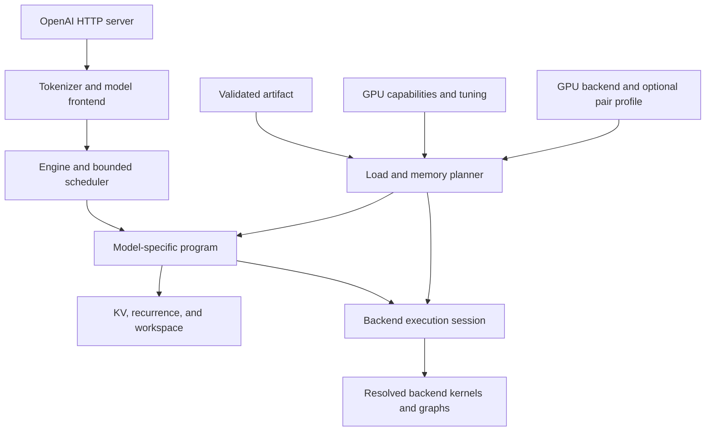

# Specialized C++ Inference Engine — Architecture and Research

**Design proposal · researched 27 October 2026 · implementation snapshot updated 29 October; no model execution, reference benchmark, or release qualification**

Current implementation and validation evidence: [docs/status.md](docs/status.md). Requirements below are not claims of completed capabilities.

**Current user-directed sequence (29 October 2026):** M0/M1/M2 code work and an easy-new-model scaffold are authorized. Native Windows is the active production target; its retained report records Debug/Release 26/26 and original-4080 smoke 19/19, but Windows retesting against the current tree is later work. Linux CUDA device-link/run, model/reference baselines and full qualification remain open. See [the implementation snapshot](docs/implementation-2026-10-29.md). Keep historical counts and all acceptance gates distinct. Each instance runs one model; an optional single-profile INI configures that model, not a multi-model router.

Build a small C++20/CUDA engine with **independent model runtimes and GPU backends, plus optional model–GPU tuning profiles**. The first shipping target is **RTX 4080 16 GB + Qwen3.8-27B GSQ3, a GPU-resident text decoder, native MTP, adjustable context, selectable KV-cache quantization, and image input with optional CPU vision/projector execution**. Ship one server executable exposing an OpenAI-compatible Chat Completions API, targeting native Windows for production and Linux host development/testing, initially with one active generation request; Linux CUDA and production qualification remain outstanding. New models implement a small model-runtime class and declare their optional capabilities.

The strongest starting point is the existing NInfer-4080 GSQ3 path. Use it as a reproducible reference and a source of concrete kernel ideas. Preserve your own module boundaries so adding a different model or a later GPU target does not require copying the entire engine. Matching NInfer or Strata is a measurement goal, not an architectural guarantee. [IMPLEMENTATION_PLAN.md, section 2](IMPLEMENTATION_PLAN.md#2-acceptance-profiles-and-performance-contract) is authoritative for acceptance: a feature-complete candidate is not a performance-qualified release until every frozen comparable case passes the 95% throughput / 110% uncached-TTFT gate.

## Contents

1. [Decisions and scope](#1-decisions-and-scope)
2. [What the reference projects contribute](#2-what-the-reference-projects-contribute)
3. [Exact model and quantization contract](#3-exact-model-and-quantization-contract)
4. [Architecture and module ownership](#4-architecture-and-module-ownership)
5. [Execution and kernel dispatch](#5-execution-and-kernel-dispatch)
6. [RTX 4080 memory plan](#6-rtx-4080-memory-plan)
7. [Artifacts and conversion](#7-artifacts-and-conversion)
8. [State, scheduling, and graphs](#8-state-scheduling-and-graphs)
9. [Optimization research backlog](#9-optimization-research-backlog)
10. [OpenAI-compatible endpoint](#10-openai-compatible-endpoint)
11. [Linux and Windows](#11-linux-and-windows)
12. [Benchmarking and correctness](#12-benchmarking-and-correctness)
13. [Implementation sequence](#13-implementation-sequence)
14. [Extension strategy](#14-extension-strategy)
15. [Risks and open decisions](#15-risks-and-open-decisions)
16. [Sources and reproducibility](#16-sources-and-reproducibility)

## 1. Decisions and scope

The server-only scope, configurable context/KV, native MTP, CPU mmproj offload, class-based model integration, independent GPU backends, and optional model–GPU specializations are requirements. Other choices below are proposed engineering decisions. “qv quantizations” is interpreted as **KV-cache quantization**, independently of Q3 model-weight quantization. Research observations are linked separately.

| Area | First iteration | Later |
|---|---|---|
| Language | C++20 host code, CUDA C++ kernels | Offline Python conversion/research remains acceptable |
| Hardware | Original RTX 4080 16 GB, SM89; only current GPU target | Other GPUs considered after the 4080 release; no Blackwell implementation work in this plan |
| Model | Exact pinned Qwen3.8-27B configuration, with text, native MTP, and image capabilities | New classes for other checkpoint geometries |
| Runtime model input | GGUF container with a finite Saga-supported architecture/encoding profile; initial target is GSQ 3-bit body, group 128, and 4-bit embedding/head | Additional profiles only after format, kernels and evaluation are specified |
| Activations | BF16 or FP16 per validated operator contract; FP32 reductions where needed | A8 routes after independent qualification |
| Cache/state | Broad independently selectable K/V catalog: F32, BF16/FP16, GGML-style Q8/Q5/Q4/IQ4_NL, and engine-owned group-64 INT8/INT4; FP32 GDN state | FP8/rotated codecs and bounded prefix retention |
| Workload | One active request; bounded waiting queue | Continuous batching if throughput becomes a goal |
| Context | User-configurable startup capacity; `auto` or explicit tokens; optional smaller per-request limit | Broader qualified context/codec combinations |
| Serving | `/v1/models`, `/v1/chat/completions`, SSE | Tools, structured output, Responses API |
| Execution | Correct eager path, CUDA Graph decode, native MTP with an off switch | DFlash2 and other proposal backends |
| Vision placement | Image encoder + multimodal projector on CPU or GPU; CPU mode keeps their weights/workspace off VRAM | Mixed encoder/projector placement and video |
| Product | One long-running server executable; server TOML plus optional one-model INI and startup flags | Additional server APIs if justified; no multi-model router implied |
| Platforms | Native Windows production build/smoke qualification; Linux host development/testing enabled through shared/native platform boundaries | Linux CUDA/model/production qualification remains outstanding; WSL2 separately measured, never called native Windows |

**v0 excludes** Blackwell implementation work, interactive generation CLI, desktop UI, video, general text-decoder weight offload, multi-GPU/distributed serving, hot model swapping, arbitrary model loading, and a generic graph compiler. Offline conversion, tests, and benchmark drivers are development tools, not additional user-facing inference products. A plain text path is an internal implementation milestone; the first feature-complete release includes MTP, image input/CPU mmproj placement, and selectable KV codecs.

Prefer statically linked modules initially. “Modular” means explicit ownership and replaceable implementations; it does not require a dynamic plugin ABI.

## 2. What the reference projects contribute

### NInfer

The current upstream is a specialized C++/CUDA single-GPU engine targeting RTX 5090. It separates model facts, stored weight representations, native execution, state, and serving; its current build/artifact assumptions are not a drop-in 4080 backend. Its published numbers are 5090 results. [N1]

**Adopt:** finite native model programs, explicit format/layout contracts, selective loading, preplanned execution resources, and independent correctness qualification. **Avoid inheriting accidentally:** Linux-only operational dependencies or instructions and packing assumptions unsupported by the RTX 4080. The architecture documentation is particularly useful for ownership boundaries. [N2]

### NInfer-4080

This is the closest reference for the first target. Its README describes GSQ3 body weights, Q4 vocabulary endpoints, SM89 kernels, compressed KV, and speculative decoding. It advertises up to 2,754 prefill tokens/s and 385 generation tokens/s in selected measured configurations; those are maintainer-reported results with speculation and workload conditions, not a plain batch-one decode target. The 32K tiled-corpus result is 385.1 tok/s with MTP3 plus n-gram chaining, versus 141.7 tok/s with `--ngram off`; native-MTP comparisons must explicitly disable that chain. Its 12.41 GiB artifact size differs from approximately 11.2 GiB loaded weights in one documented profile. [F1]

Source inspection confirms distinct one-token, small-token-count tensor-core, and tall-prefill Q3 routes with shape and layout guards; A8 has a separate permission and workspace path. This supports phase-aware dispatch rather than one universal “Q3 matmul.” Do not copy its crossover thresholds without remeasurement. [F2]

**Adopt:** its Q3 representation as a compatibility reference, tile/dequantization experiments, and SM-count-aware launch budgeting. Independently reproduce its fit and correctness claims before relying on them.

### Strata

Current Strata documentation emphasizes heterogeneous execution of much larger MoE models: GPU-resident common work and cached experts, CPU execution of uncached experts, and disk-backed tables. That differs materially from a fully resident dense 27B model. Its Windows/Linux packaging is relevant, but its headline throughput is not automatically an apples-to-apples comparison. [S1, S2]

**Adopt:** explicit placement plans, bounded resource policies, model-aware state handling, and useful deployment diagnostics. Defer expert offload machinery until a selected MoE model requires it.

### Switchyard

Switchyard is a cluster serving project built around Dynamo, Slurm, vLLM, and prefill/decode disaggregation. Its useful local-engine contribution is the documented model-shape-specific fusion work: gate/up + SwiGLU, paired GDN projections, and guarded fallbacks. Its own kernel notes distinguish operator improvements from end-to-end gains. [Y1, Y2]

**Adopt:** phase separation, exact shape guards, and whole-model verification of fusion benefits. Defer the distributed control plane and P/D transfer machinery.

### Deeper source inspection: where the speedups come from

This section distinguishes **observed implementation mechanisms**, **repository-reported measurements**, and **proposed adaptations**. Inspection uses the pinned revisions in section 16. Finding a kernel in a repository does not establish that every model/profile dispatches to it, and no kernels were benchmarked locally. Large execution files were examined selectively around relevant paths rather than audited in full.

#### NInfer-4080: most immediately applicable

| Mechanism observed in source | Why it can help | Dependency and adoption decision |
|---|---|---|
| Staged Q3 GEMV: eight 128-code groups per stage, three-stage asynchronous-copy pipeline; decode an eight-code window once and reuse weights across token columns | Hides packed-weight load latency and reduces repeated unpack work | CUDA load pipeline + exact Q3 layout; adapt first for Qwen3.8-27B decode [D1] |
| Small-T Q3 tensor-core path: whole 48-byte groups copied as three 16-byte vectors; 32 output rows; native 8/16-column tiles; K split across warps | Coalesces reads, reuses weights across verify columns, and exposes tensor-core work without a tall-prefill tile | 4080 shared-memory/register budget; adapt for MTP verification [D2] |
| Tall Q3 GEMM: 128 weight rows × 64/128 tokens, register lookahead, double-buffered shared memory, `cp.async`, `ldmatrix`, BF16 MMA with FP32 accumulators | Overlaps load, unpack and matrix arithmetic; amortizes weights over prompt tokens | Strongly hardware/layout dependent; adapt for prefill and tune on actual projection shapes [D3] |
| Permuted shared-memory addressing for matrix loads | Avoids bank conflicts while feeding tensor-core fragments | An internal kernel layout, not a new model format; preserve its packing/alignment guards [D2, D3] |
| Separate A8 routes: INT8 activation groups and INT32 tensor-core partial dots, scaled into FP32 | May improve prefill/small-batch arithmetic throughput | Changes activation numerics; keep explicit permission and evaluate quantization overhead [D4] |
| Q3 fused gate/up + SwiGLU, including decode and small-T paths | Avoids materializing the full projection plane and separate activation launches | Model shape is explicitly 34,816 × 5,120; qualify this model's rounding contract [D5] |
| Cooperative GDN projection capacity derived from SM count and per-SM residency | Keeps cooperative grids legal and bounds token tiles without assuming a larger GPU | 4080-specific resource planning; adopt the principle, not a permanent copied occupancy table [D6] |

The fork's dispatch header uses small-T widths up to 16, 8/16-column variants, and an A8 tall-path threshold of 129 tokens. These are observed choices, not universal crossover points. Test the actual launch combinations used by MTP: draft count 3 does not mean every projection sees exactly three token columns. [D7]

**Specific 4080 lesson:** the residency table documents 76 SMs and resource counts from compiled CUDA 13.1 cubins. A cooperative grid must fit simultaneously; more unrolling or fusion can increase registers and change that bound. Recheck occupancy after compiler or kernel changes, compare with runtime occupancy queries, and retain a non-cooperative fallback. [D6]

One inspected compressed-attention path groups the GQA query heads sharing a KV head within a CTA and stages compressed K/V before matrix work. Its source uses rotated FP8 K and packed NVFP4 V widened for arithmetic. It is evidence for **sharing KV reads across query heads and overlapping codec work**, not a drop-in implementation of our symmetric INT4 codec or proof that every low-bit path has the same hardware requirements. Map each proposed cache codec to its actual 4080 instructions and qualified reader. [D8]

#### NInfer: execution overhead and recurrent-state traffic

**Graph handling.** The core has explicit graph capture, instantiate/update, upload and launch operations. Its Qwen program defines context resource tiers rather than one worst-case attention envelope for every token. Graph calibration measures allocation changes before capture, after graph preparation, and after graph release. Adopt these mechanisms within the Qwen3.8-27B program: pre-upload graphs, bound inactive attention work, and measure real graph overhead before finalizing context capacity. Graph update compatibility must be checked; it is not guaranteed by similar shapes. [D9, D10, D11]

**ReplaySSM.** Instead of saving a full GDN matrix at each verify position, the documented scheme retains the committed state and raw transition inputs—pre-normalization K, V, log-decay gate and correction gate—then folds only the accepted prefix. Convolution history is restored from recorded projected columns. Replay must match verify's finite-precision normalization, reductions, gates and operation order; algebraic equivalence alone can drift across rounds. The target-verification code explicitly requests replay records. [D12, D13]

For the current 27B geometry, the derived storage comparison is:

| Window-dependent storage | Per verify input | Four inputs: anchor + three drafts |
|---|---:|---:|
| Full recurrent + convolution image | 146.8125 MiB | 587.25 MiB |
| Raw GDN + convolution input record | 1.705078125 MiB | 6.8203125 MiB |

These figures exclude the common starting checkpoint, transient execution state and other MTP buffers. They are **storage/traffic calculations, not an 86× engine speedup**. Replay adds accepted-prefix computation. Use full snapshot/replay as the oracle, then prioritize raw-input ReplaySSM for the 4080 MTP implementation after exact-state tests pass. [D12]

**Proposal width and lookup.** The 4080 fork's n-gram policy can extend MTP with matching context tokens and only selects a wider verification window when the usable extension clears a margin. This avoids paying a wider verify cost for a tiny lookup. It remains later work here, and a stochastic implementation must model the actual proposal distribution rather than borrowing a greedy matching policy unchanged. [D14]

#### Strata: phase-dependent resource use and the future Flash-Next model

| Observed mechanism | Applicability |
|---|---|
| Bounded expert staging rings with copy/compute streams and per-slot completion events; prefill chooses CPU sharing versus streaming according to chunk size and measured costs | Mainly future Flash-Next/MoE work. Generalize the bounded transfer/lifetime discipline for current CPU vision handoff; do not add expert offload to dense 27B [D15] |
| Expert cache stores residency/slots and can save learned rankings using resident status, access heat and prior rank | Future model-placement research. The inspected insertion path deliberately stops inserting when full; do not describe the entire cache as a generic LRU or infer unrestricted live eviction [D16] |
| Draft policy estimates tokens per measured round time, maintains context cost buckets, probes unseen/stale widths and discounts first-use capture distortion | Adapt a smaller controller for MTP widths 0–3; optimize net committed tokens/s, not acceptance alone [D17] |
| CPU pool uses topology/affinity information, separates host and worker cores, and includes spin/sleep policies | Relevant to CPU vision and server responsiveness. Benchmark physical-core and worker counts; do not copy an expert-pool spin policy into occasional image work [D18] |
| Chunked GDN computation reduces the token-serial chain; a tensor-core variant and FP32 alternative coexist | Algorithmic inspiration, with numerical/state qualification. The inspected WMMA dispatch specifically checks compute capability 7.0, so that route is not automatically a 4080 implementation [D19] |
| Optional message-boundary checkpoints avoid replaying a long history after the final user message is edited | General server/agent optimization. Add later with complete hybrid-state snapshots; source performance notes combine other policy changes and are not an isolated upstream speedup [D20] |

Strata also documents opt-in **output-head/prefill-buffer aliasing**: free or repurpose head memory during prompt processing, then reload it before generation. Its measurements show long-prompt benefits alongside reload costs and worse short-follow-up latency, with an address guard because captured graphs retain pointers. This is a useful negative lesson for our design: keep weights resident by default. Consider phase memory borrowing only if the measured prefill gain exceeds reload/recapture costs and stable-address ownership is solved. The reported experiment is on a different GPU/model profile; it is not evidence of a 4080 gain. [D21]

For future Flash-Next, NInfer's dedicated execution reference describes CPU/GPU expert work, disk-backed PLE preparation, double-slot uploads, sparse-attention/state frontiers and segmented graphs. These are architectural differences from 27B dense, not optional flags to attach to its class. Defer those implementations, but retain the shared allocation/completion/capability infrastructure needed to host the later separate runtime. [D22]

#### Switchyard: shape-specific fusion with guarded numerical behavior

The dense Triton operator computes gate/up together and fuses SwiGLU; batches 2–16 reuse tiles across token rows, while unsupported widths fall back. It explicitly rounds gate/up projections through BF16 before activation. Its paired GDN projection combines QKVZ and BA into one launch. The MoE source uses two specialized kernels for routed gate/up and down/reduction rather than a generic sorted/padded grouped path. Adapter predicates check dtype, contiguity, shape and unquantized/bias conditions. [D23, D24, D25, D26]

Two adoption constraints matter:

1. Switchyard's BF16 operator and the 4080 fork's fused Q3 epilogue do not establish an identical intermediate-rounding contract. Freeze our reference arithmetic and qualify each fusion against it, rather than assuming that similarly named SwiGLU kernels are interchangeable.
2. Reported dense-operator improvements were measured on H200. The cluster serving results do not establish an isolated end-to-end contribution from those adapters. Port the fusion idea to a model-specialized CUDA backend kernel, then perform an equal-precision 4080 A/B test. [Y2, D5, D23, D27]

### Resulting 4080 optimization order

Implement these experiments as CUDA backend operators or optional `qwen3_8_27b` specializations, selected by the pair profile. The model retains the equations, fusion permissions and correctness contract.

1. Establish exact packed-layout, layer, continuation and plain-decode references.
2. Benchmark staged Q3 GEMV, small-T verify GEMM and tall prefill GEMM separately. Measure actual N/K/T shapes and memory traffic, not a synthetic square GEMM alone.
3. Add gate/up fusion with a frozen rounding contract and tune GDN projection residency using the built cubin.
4. Capture/upload the selected graph profiles and bound attention resources by context tier; account for graph memory.
5. Implement raw-input recurrent replay and convolution-column restoration, checking state directly at every accepted length.
6. Fuse selected KV append/read/dequantization into Qwen attention and share GQA KV loads. Evaluate each configured codec and long-context quality independently.
7. Add a cost-based MTP width controller after fixed widths are measured. Treat A8, prompt lookup, prefix caching and phase memory borrowing as separate experiments with independent quality/latency gates.

For each experiment record: source idea, implemented delta, device/build/artifact, precision/rounding, N/K/T or context, kernel latency, full-round latency, committed tokens/s, peak VRAM and state/quality results. No source-level trick is accepted solely because another engine advertises high throughput.

### Build from scratch or extend a fork?

Maintain a runnable, pinned NInfer-4080 baseline alongside the new engine. For maximum time-to-performance, extract or adapt qualified operators with attribution where licensing permits. For maximum implementation independence, retain the same baseline as an external oracle and write your operators separately. Either approach benefits from the architecture below; a full fork is not required to reuse a proven kernel.

## 3. Exact model and quantization contract

### Exact model naming and future Flash-Next integration

Use the full model variant in integration names. **Qwen3.8-27B** is the current dense target; **Qwen3.8-Flash-Next** is a later, separate model integration. Avoid a catch-all `qwen38` runtime or kernel namespace.

| Identity | Current dense model | Reserved future model |
|---|---|---|
| Display name | `Qwen3.8-27B` | `Qwen3.8-Flash-Next` |
| Runtime/definition ID | `qwen3_8_27b` | `qwen3_8_flash_next` |
| C++ classes | `Qwen38_27BDefinition`, `Qwen38_27BRuntime` | `Qwen38FlashNextDefinition`, `Qwen38FlashNextRuntime` |
| Model directory | `src/models/qwen3_8_27b/` | `src/models/qwen3_8_flash_next/` |
| Optional specialization profile | `qwen3_8_27b_gsq3` + `rtx4080` | Separate Flash-Next profile; compatible backend kernels remain reusable |
| Public server alias | `qwen3.8-27b-gsq3` | A distinct Flash-Next alias |

Quantization, artifact revision and device tuning are separate identity fields; `gsq3` belongs to an artifact/kernel profile, not the model's mathematical definition. Reserve Flash-Next's names now, without implementing or registering that runtime in the 4080 release.

The inspected official configurations differ materially: the 27B target has 64 layers, hidden width 5,120 and a dense FFN; Flash-Next declares 48 layers, hidden width 2,560, 512 routed experts with top-10 selection, two KV heads, and indexer/PLE-related configuration. Its declared family is `qwen4_exp`, whereas the 27B checkpoint declares `qwen3_5`. This validates separate config binders, native programs and state schemas, with distinct operator requirements. [Q1, Q3]

### The model is a hybrid recurrent architecture

The official configuration identifies Qwen3.8-27B using the `qwen3_5` family and supplies the following geometry. Model names alone must not select execution. [Q1]

| Property | Value |
|---|---:|
| Text layers / hidden width / FFN width | 64 / 5,120 / 17,408 |
| Full-attention / linear-attention layers | 16 / 48 |
| Layer pattern | Three linear-attention layers, then full attention |
| Full-attention query heads / KV heads / head dimension | 24 / 4 / 256 |
| Linear key heads / value heads | 16 / 48 |
| Linear key/value head dimension | 128 / 128 |
| Convolution width / recurrent state dtype | 4 / FP32 |
| Vocabulary matrix rows | 248,320 |
| Embedding/output tying | Untied |
| Partial rotary factor / maximum configured positions | 0.25 / 262,144 |

The configured position limit is not a promise that this engine supports that context on 16 GB.

Implement both gated grouped-query attention and Gated DeltaNet (GDN). Full attention needs growing KV; GDN needs fixed-size recurrent matrices and convolution history. A prefix checkpoint must restore both. Consult the pinned model implementation/reference for exact gates, normalization, projection ordering, and recurrence—not just the GDN paper. [N3, R1]

Important importer checks include zero-centered versus ordinary RMSNorm, per-head Q/gate row ordering, Q/K normalization, partial rotary mapping, and causal-convolution history. These details need explicit golden fixtures; a plausible generated answer is insufficient evidence of correctness. [N3]

### “Q3” must identify a representation

Recommended v0 checkpoint: `ISTA-DASLab/Qwen3.8-27B-3Bit-GSQ`. Its card specifies 3-bit GSQ body weights with group size 128 and separate 4-bit RTN embedding/head weights with group size 64. It also says the published checkpoint omits MTP components. The first-release artifact therefore must add separately sourced, compatible MTP weights and validate them against the matching original checkpoint. Missing MTP weights are a startup error when `speculation.mode = "mtp"`, rather than a silent downgrade. [F3] [Q2]

For a proposed symmetric body encoding with one FP16 scale per 128 values:

```text
represented_weight = signed_3bit_code * fp16_group_scale
body storage = 3 + 16/128 = 3.125 bits per weight, before padding/alignment
```

Validate the source codes, signedness, grouping axis, and scales before applying that formula. “GSQ” describes how quantization was produced; the artifact must still specify its exact numerical and physical encoding.

GGUF is the required runtime input container, but that does not make its common quantized tensor types numerically interchangeable with Saga's target. GGUF `Q3_K` has a different block representation (3.4375 bits per weight), and model-wide Q3_K recipes can mix tensor types. GSQ3, Q3_K/Q3_K_M, IQ3, and raw three-bit packing are distinct encodings; compatibility requires the same actual represented values, including scale conversion/rounding. The exact GSQ/Q4 GGUF payload mapping and profile remain unresolved M0/M3 gates. A supported profile may use namespaced metadata and verified standard typed code/scale tensors; do not invent GGUF tensor-type IDs, relabel a payload as Q3_K/IQ3, or imply universal llama.cpp interoperability. [G1]

## 4. Architecture and module ownership

The important separation is **model mathematics × numerical representation × hardware implementation × workload phase**. Each axis should be explicit without turning execution into a general-purpose tensor interpreter.



| Module | Owns | Boundary |
|---|---|---|
| Gateway | HTTP/JSON/SSE, connection lifecycle | Submits typed requests; never launches model kernels |
| Model frontend | Tokenizer, chat template, thinking/stop parsing, incremental UTF-8 | Produces owning token buffers and output events |
| Engine | Request records, cancellation, queue, lifecycle | Publishes committed results only |
| Scheduler | Admission and next execution unit | Uses resource availability; does not encode layer math |
| Model runtime | Exact layer order, dimensions, fusion sites, state semantics | Implements the model class; creates native prefill/decode/verify plans |
| Vision executor | Image preprocessing, encoder/projector computation, feature handoff | Bounded CPU/GPU jobs; never advances text state |
| KV codec | Numerical encoding, scales, packing, append/read kernels | Declares supported K/V pairings and phase/attention compatibility |
| Artifact reader | Bounds, versions, tensor metadata, provenance | Does not guess formats from filenames |
| Planner | Device placement, liveness, memory budget, kernel resolution | Fails before readiness if configuration cannot fit |
| GPU backend | Buffers, streams, graphs, kernel implementations and support predicates | Resolves the model’s typed operator requirements into device execution |
| Device profile | Capabilities, card tuning, measured thresholds | Independent of model identity |
| Model–GPU profile | Optional preferred kernels, tiles, fusion recipes and layout choices | Overrides defaults only when compatibility checks pass |
| State stores | Physical KV pages, recurrent images, ownership | One authoritative resource ledger |
| Platform layer | Files, mapping, timers, sockets integration | No platform conditionals inside model math |

Use virtual interfaces or a tagged variant at coarse model-selection boundaries. Inside a resolved model program, use concrete implementations/templates or prebound function pointers. A CPU function-pointer call per kernel launch is often negligible; measure before introducing extensive template instantiation. Avoid per-token registry lookups, string dispatch, heap allocation, and tensor-shape inference.

Illustrative contracts, not an implemented API. All named support types below need concrete definitions during implementation.

```cpp
struct KernelKey {
    OpKind op;
    Phase phase;                  // prefill, decode, verify
    WeightEncoding weights;
    ActivationFormat activation;
    LayoutId layout;
    ShapeSignature shape;
    NumericalContractId numerics;
    KvPairId kv_pair;             // none for operations without KV
};

class IModelDefinition {
public:
    virtual ~IModelDefinition() = default;
    virtual ModelSpec inspect(const ArtifactMetadata&) const = 0;
    virtual ModelProgram describe_program(const ModelSpec&,
                                          const RuntimeOptions&) const = 0;
    virtual std::unique_ptr<IModelRuntime> instantiate(
        const ModelSpec&, const ExecutionPlan&, const ArtifactView&,
        RuntimeServices&) const = 0;
};

class IGpuBackend {
public:
    virtual ~IGpuBackend() = default;
    virtual DeviceCaps capabilities() const = 0;
    virtual BackendPlan lower(const ModelProgram&, const RuntimeOptions&,
                              const PairTuningProfile*) = 0;
    virtual std::unique_ptr<IExecutionSession> instantiate(
        const BackendPlan&, const ArtifactView&, ResourceGrant&) = 0;
};

class IModelRuntime {
public:
    virtual ~IModelRuntime() = default;
    virtual SequenceHandle create_sequence(const SequenceOptions&) = 0;
    virtual PendingStep prefill(const PrefillBatchView&,
                                ExecutionContext&) = 0;
    virtual PendingStep decode(const DecodeBatchView&,
                               ExecutionContext&) = 0;
    virtual Completion release_sequence(SequenceHandle,
                                        ExecutionContext&) = 0;
    virtual IMtpRuntime* mtp() noexcept { return nullptr; }
    virtual IVisionRuntime* vision() noexcept { return nullptr; }
    virtual ICheckpointRuntime* checkpoints() noexcept { return nullptr; }
};

class IMtpRuntime {
public:
    virtual ~IMtpRuntime() = default;
    virtual PendingTransaction begin_round(const SpecBatchView&,
                                           ExecutionContext&) = 0;
    virtual PendingDraft propose(SpecTransaction&, const DraftOptions&,
                                 ExecutionContext&) = 0;
    virtual PendingVerify verify(SpecTransaction&, const DraftBatch&,
                                 ExecutionContext&) = 0;
    virtual Completion commit(SpecTransaction&, const CommitDecision&,
                              ExecutionContext&) = 0;
    virtual Completion abort(SpecTransaction&, ExecutionContext&) = 0;
};

class IVisionRuntime {
public:
    virtual ~IVisionRuntime() = default;
    virtual PendingMedia encode(const MediaInput&,
                                 VisionExecutionContext&) = 0;
};
```

### One model integration entry point

Register `Qwen38_27BDefinition : IModelDefinition` once. It bundles importer mappings/converter hooks, config validation, tokenizer/template and output policies, operator requirements and optional fusion recipes, state schema, capability descriptors, and runtime factory. `Qwen38_27BRuntime : IModelRuntime` implements execution and provides MTP/vision/checkpoint helpers. Contributors get one integration directory and registration point; they do not modify the scheduler or HTTP routes for capabilities already understood by the server.

A new mathematical architecture can still require new kernels, state semantics, and conversion logic. The class interface reduces integration boilerplate; it cannot implement unknown model mathematics automatically. Do not require unrelated models to implement optional providers.

### Inspect, plan, allocate, warm, publish

1. `inspect(metadata)` reads no weight payload into VRAM and returns immutable `ModelSpec`: exact geometry, validated component bindings and byte extents, source identities, frontend policy, state schema, and capability matrix. Reject malformed bindings and missing structurally required text components here; record optional-component availability. The following planning step rejects options that request missing MTP/vision components.
2. The model describes a bounded native `ModelProgram` from `ModelSpec` and options. The common planner asks the selected backend to lower its typed calls, optionally applying a compatible pair profile, and returns an address-free `ExecutionPlan`: resolved context, kernel selections, physical tensor deduplication, pool layouts, allocation ledger, graph profiles and limits. Planning inputs explicitly include artifact metadata. If context is `auto`, evaluate candidates using this same planner.
3. The central resource owner issues a **bounded bring-up grant**, not serving approval. All enabled project-owned allocations must be known; external/runtime overhead must have an explicit conservative reservation and enforced abort limit. The backend creates a session from that immutable physical plan; `instantiate(spec, granted_plan, artifact, services)` binds only granted buffers and calls. No model allocates undisclosed persistent resources. Failure unwinds partially prepared resources.
4. Warm the selected path and capture graphs only when enabled. Reconcile actual high-water marks, library/driver allocations and graph overhead against the grant. If the plan no longer fits, rebuild at a smaller context only for an `auto` profile, or reject an explicit profile. No requests are accepted during calibration or replanning.
5. Issue **reconciled readiness approval** for the selected profile and publish its plan hash only after all enabled terms are measured/accounted for. Serving uses that same plan; validation and allocation must never derive parallel, inconsistent interpretations of options.

Approval has three distinct stages:

| Stage | Permitted evidence gaps | Permission |
|---|---|---|
| Static candidate | Explicitly unresolved external/runtime or future-component terms | Calculate/report only; no fit claim or serving |
| Bounded bring-up grant | Uncalibrated external overhead only when conservatively reserved and bounded; no unknown enabled project allocations | Internal allocation, warmup and calibration; no serving |
| Reconciled readiness approval | No unresolved enabled allocation/overhead terms | Serve only the warmed/captured profile |

An eager graph-disabled profile needs no graph allocation or future graph measurement. Its measured eager readiness does not approve a later graph-enabled profile. Adding MTP, a codec or vision placement requires a new profile/grant and reconciliation. An unbounded or unreserved unknown blocks bring-up; calibration is not permission to overcommit memory.

### Batch-ready execution with a single-request first release

`PrefillBatchView`, `DecodeBatchView`, and `SpecBatchView` carry arrays of sequence handles, input token spans/positions, state mappings, and active-row metadata. Decode rows initially contain one consumed input token per sequence; prefill rows hold bounded chunks. The first release accepts only batch size one, but the API does not bake a single sequence/token into the runtime signature. Later batching changes implementations and planning without replacing the integration interface.

The model owns sequence state and mathematical frontiers; common stores own physical allocation and lease accounting. Prepared media travels with prompt chunks as feature views plus image grid/position metadata. Opaque handles have generation counters so a released/reused slot cannot be accessed through an old handle.

### Uniform asynchronous lifetime and failure contract

`ExecutionContext`, tensor views, completion tokens and sequence/state handles are backend-neutral contracts; model headers do not expose `cudaStream_t`, CUDA allocation APIs or SM-specific constants. The CUDA execution session owns their physical interpretation.

Every operation that enqueues CPU/GPU work returns `Completion` or a `Pending<T>`-style result containing a completion token, status channel, and resource lease. The completion covers all contributing CPU jobs and CUDA streams. Results are readable only after successful completion; backing remains valid until both execution completes and the consumer releases its lease. `begin_round`, `commit`, `abort`, media encoding, and sequence release obey the same rule as prefill/decode.

The execution worker orders dependent operations with events or explicit waits, settles the result, and only then publishes committed output. A request cancellation does not free buffers used by submitted work. `release_sequence()` is deferred reclamation and returns a completion; generation counters invalidate the handle immediately while storage waits for users/fences to retire.

`SpecTransaction` is move-only and has states `pending → active → committing/aborting → settled`. An uncommitted transaction's destructor is nonthrowing and enqueues a rollback record on the execution worker; it does not invoke CUDA from an arbitrary HTTP thread. Its leases survive until rollback completes. Reserve a non-allocating cleanup record when the transaction begins so destructor cleanup cannot fail because a queue is full or memory allocation fails. The resource owner must outlive this cleanup queue. Commit and abort are mutually exclusive, settle once, and expose asynchronous failure through their completion. Failed rollback or unrecoverable device errors invalidate affected state and mark the engine unavailable; never reuse a partially restored sequence. Shutdown stops admission, cancels/drains work, settles transactions, joins workers, then releases buffers.

A kernel support predicate must include dtype, alignment, dimensions, strides, quantization group, physical layout, device capability, workspace, and numerical permission. Unsupported combinations fail clearly or use an explicitly qualified fallback. Never silently reinterpret data or add activation quantization.

Suggested future tree:

```text
include/engine/       public engine, request, result, and configuration types
src/api/             OpenAI protocol adapter and SSE
src/frontend/        tokenizer integration and model-specific templates
src/core/            ownership, buffers, logging, errors
src/platform/shared/ common checks, UTF-8 validation and platform-neutral behavior
src/platform/windows/ native Windows files, environment and console shutdown
src/platform/linux/   enabled Linux host selection using reusable POSIX implementations
src/platform/posix/   reusable POSIX calls; Linux/macOS host support, not CUDA or production qualification
src/runtime/         scheduler, admission, cancellation, plans
src/artifact/        reader, manifest validation, binding
src/models/qwen3_8_27b/       definition, bindings, frontend, state and native program
src/models/qwen3_8_flash_next/ reserved future integration; no current build target
src/backend/                 operator contracts, sessions and capability resolution
src/backends/cuda/           CUDA allocation, streams, events and graph support
src/backends/cuda/kernels/common/ shared qualified CUDA primitives
src/backends/cuda/kernels/sm89/   reusable SM89 implementations; no per-SKU copies
src/backends/cuda/specializations/qwen3_8_27b/ optional exact-shape/fusion kernels
src/backends/cpu/            CPU operators for vision; no text offload requirement
src/devices/rtx4080/         model-independent capability/tuning defaults
profiles/qwen3_8_27b/rtx4080/ optional measured pair preferences
src/memory/          KV pages, recurrent images, arenas
apps/server/         sole user-facing executable
src/vision/          CPU/GPU encoder-projector execution and staging
src/kv/              codec descriptors, packing and kernel bindings
converter/           offline conversion and packing
bench/               fixed workloads, kernel suites, result schemas
tests/               independent operator/state/API qualification
```

## 5. Execution and kernel dispatch

### Separate phase-specific paths

| Phase | Starting implementation | Why |
|---|---|---|
| Decode, one token | Fused Q3 unpack + A16 GEMV | Weight bandwidth and unpack cost dominate many projections |
| Verification/small token count | Q3 unpack into tensor-core-compatible tiles + A16 GEMM | Reuses weights across several token columns |
| Prefill | Tiled Q3/A16 GEMM with bounded chunks | More activation reuse; different tile/workspace optimum |
| GDN decode | Recurrent update over one token | Maintain matrix and convolution state directly |
| GDN prefill | Chunkwise formulation with matching boundary state | Avoid serial token-by-token prompt processing |
| Full-attention prefill | Tiled causal attention with online softmax | Avoid materializing the quadratic score matrix |
| Full-attention decode | GQA over paged KV; context-dependent partitioning | Increasing context changes bandwidth and parallelism |

There is no native three-bit matrix instruction to assume for this route. Keep weights packed in VRAM and unpack/dequantize tiles into supported arithmetic operands near consumption. Expanding the whole model to BF16 defeats the memory objective. A16 means 16-bit activations; BF16 and FP16 remain distinct execution contracts.

Use cuBLASLt/CUTLASS or a simple CUDA implementation as qualified baselines for supported operations. They are not automatic drop-in readers of your Q3 layout. A dequantize-then-library-GEMM fallback should use bounded tiles/layers and be measured for temporary memory and extra reads. [R2]

### Independent model and GPU modules, with optional pair specialization

**Reuse implementations by architecture; tune by card; specialize algorithms where measured benefit justifies it.** The unit of GPU specialization is a kernel implementation, compiled variant, packing layout or execution profile—not a copy of the server, scheduler, frontend or model runtime. Common CUDA primitives and SM89 kernel families serve compatible hardware. RTX 4080 and RTX 4090 are both Ada SM89 devices and can reuse compatible implementations, but launch bounds, occupancy, tiles and crossover points must be measured per card. Reuse is not qualification: only the original 4080 is a qualification target in this release, and none of these proposed implementations is qualified yet. A future RTX 5080 is a different architecture: compatible CUDA algorithms may remain reusable after appropriate compilation and validation, but optimized support can require new kernels, layouts and instruction paths plus its own card profile. It is not a renamed 4080 profile, and no Blackwell implementation is included now.

Use three separately registered components:

| Component | Knows | Does not own |
|---|---|---|
| `Qwen38_27BDefinition` / runtime | Model equations, layer order, state/frontiers, tokenizer and logical weights | CUDA streams, SM counts, block sizes or GPU allocation APIs |
| `CudaBackend` + shared SM89 kernel implementations + `Rtx4080Profile` | Device execution, buffers, graphs, operator/layout support; per-card measured launch choices | Qwen message templates, layer numbering or reasoning semantics |
| Optional `qwen3_8_27b × rtx4080` profile | Measured kernel/fusion/layout preferences for that exact pair | Independent copies of the model or backend |

The model requests typed operations with logical shapes, numerical contracts, weight encoding and allowed fusion boundaries. The backend supplies compatible implementations. Model-specific optimized kernels remain supported as optional backend specializations; they are not required to live inside the model class or to be duplicated for every GPU. Shared implementations can serve multiple models when the full operation and numerical contracts match.

For example, a shared `Sm89Q3Decode` family may contain several compiled tile/pipeline variants. `Rtx4080Profile` selects the measured 4080 defaults; a future 4090 profile may select different variants without changing the Qwen layer program. Tile dimensions, staging depth, attention partitions and phase crossover points are tuning choices. A genuinely different card-specific algorithm may instead register a separate guarded implementation; sharing is a default, not a requirement to sacrifice performance. Do not create parallel `engine_4080/` and `engine_4090/` trees containing duplicate API, scheduling, frontend and model logic.

| Concern | Shared where compatible | Card/model–GPU-specific choice |
|---|---|---|
| Model mathematics and logical weights | One model definition, state schema and native phase program | No copy per card; changing the device alone does not change the equations |
| Kernel implementation | Architecture family and compiled variants | Measured variant selection, or a dedicated algorithm when justified |
| Physical packing and workspace | Common layout when valid and performant | Explicit alternate layout/workspace, counted in the allocation plan |
| Launch and phase policy | Qualified valid defaults | Measured tiles, pipeline depth, partitions and crossover thresholds |
| Graph execution | Shared preparation/lifetime machinery | Selected profile's addresses, context tiers and resource bounds |
| Qualification | Common test and benchmark procedures | Separate actual-device correctness, fit, lifecycle and performance evidence |

These are ownership rules and proposed tuning dimensions, not measured 4080/4090 choices. A card profile owns limits and preferences, while the kernel implementation owns the actual algorithm. An optional pair profile ranks compatible candidates for exact model shapes; it cannot invent support or alter the model's numerical permissions.

A finite `ModelProgram` is the model's native ordered calls and legal alternatives for prefill/decode/verify—not an arbitrary tensor graph compiler. Resolve it once into an `IExecutionSession` whose calls are prebound. The hot loop uses concrete launchers/templates or prebound calls; there is no per-token registry lookup or generic graph interpretation. A model can provide a fused operation contract plus a mathematically equivalent qualified decomposition. Backend kernels may select that fusion only if its rounding/state semantics match the model contract.

Resolution order:

1. Filter by exact operation, shape, encoding, physical layout, dtype, numerical contract, workspace and device capability.
2. Apply a compatible model–GPU profile to rank those valid candidates. A profile cannot override correctness checks.
3. Select a qualified backend default or the model's approved decomposition when no pair specialization is available.
4. If nothing satisfies the contract, reject startup with the missing operation/format/device combination. Never silently change quantization or precision.

### Kernel implementation classes and startup binding

A C++ interface with function overriding is appropriate for **describing, checking and preparing a kernel implementation at startup**. It does not require a virtual device function or virtual dispatch for every token. Illustrative backend-side contracts (support types are defined during M2):

```cpp
class IKernelImplementation {
public:
    virtual ~IKernelImplementation() = default;
    virtual KernelDescriptor descriptor() const = 0;
    virtual bool supports(const KernelRequest&, const DeviceCaps&) const noexcept = 0;
    virtual PreparedKernel prepare(const KernelRequest&,
                                   KernelPreparationContext&) const = 0;
};

class Sm89Q3Decode final : public IKernelImplementation {
public:
    KernelDescriptor descriptor() const override;
    bool supports(const KernelRequest&, const DeviceCaps&) const noexcept override;
    PreparedKernel prepare(const KernelRequest&,
                           KernelPreparationContext&) const override;
};
```

`PreparedKernel` holds a nonvirtual launch entry, immutable launch parameters, physical binding/layout requirements and workspace declarations. Preparation is address-free or uses only an existing resource grant; it cannot allocate undisclosed persistent memory. The approved session binds granted addresses once and either calls that concrete launch entry or captures it into a CUDA Graph. The implementation object's lifetime and any launcher metadata must cover session use.

Compose `Sm89Q3Decode` with `Rtx4080Profile` tuning data; do not create a mandatory `Rtx4080Q3Decode`/`Rtx4090Q3Decode` inheritance hierarchy for every operator merely to encode different tuning constants. A genuinely different algorithm can supply another `IKernelImplementation` and override these startup methods. A dedicated card-specific kernel class is allowed when measured benefit justifies it, but is registered as a guarded candidate rather than requiring a fork of the architecture family, model runtime or engine. Templates/internal device functions provide compile-time tile specialization within each implementation. Pair profiles rank valid candidates, never override `supports()` or numerical permissions. Fake-backend tests must show that replacing one kernel or removing a tuning profile requires no scheduler/model fork.

For example, a specialized fused gate/up + SwiGLU candidate may require a compatible SM89 device, the exact GSQ3 physical encoding, a supported projection shape, BF16 activations, a particular phase/token width, aligned strides, bounded workspace and the model-approved intermediate rounding. Startup resolution checks all those predicates before ranking the candidate. If any fails, select another qualified implementation or decomposition; if none exists, reject startup with the missing contract. A matching GPU name or model name alone is insufficient. Test each guard with an incompatible request and prove that a forced pair preference cannot bypass it. Bind the chosen launcher once or capture it into a graph; the guards do not become per-token registry searches.

Weight packing is an explicit boundary: keep a canonical logical/encoded artifact and let the selected backend generate a content-addressed packed cache where needed. Layout requirements, duplicate storage and transformation error enter the approved plan. Model source does not assume CUDA-specific tensor strides; the bound session holds those physical views. CPU vision uses the same separation, with model preprocessing/encoder equations and CPU-provided operators.

Example startup selections (illustrative configuration, not implemented commands):

```toml
[model]
runtime = "qwen3_8_27b"

[backend]
type = "cuda"
device = 0

[tuning]
profile = "auto"  # optional qwen3_8_27b × rtx4080 match
```

Changing the model replaces its definition/program and resolves new kernels on the same backend. Changing to another supported GPU retains model code and resolves a new backend/device plan. Replan allocation, packing, warmup and graph capture at startup; interchangeability does not mean hot swapping or universal support. Only RTX 4080 is qualified in the current scope; Blackwell implementation remains excluded.

Tuning-cache identity includes model/config/artifact hashes, backend/device identity, driver/toolkit, kernel build hash, layout, actual N/K/T, phase, context, activation dtype, KV pair and MTP width. Ship deterministic defaults and reject stale cache entries. This preserves both modularity and exact-pair optimization without creating a full model-by-GPU source tree.

## 6. RTX 4080 memory plan

The original RTX 4080 has 16 GB GDDR6X and nominal 716.8 GB/s bandwidth. Read actual available device memory at startup; display and driver use reduce the engine budget. Do not substitute 4080 Super specifications. [H2]

### Weight estimates

For illustration, 27 billion uniformly three-bit values occupy about 9.43 GiB; group-128 FP16 scales raise this to about 9.82 GiB. This is a rough storage calculation, not the actual loaded model size. Mixed Q4 endpoints, higher-precision tensors, padding, selected vision/MTP placement, and packing layouts change the total.

Compute exact bytes from a manifest before uploading weights. Count embedding and untied output head separately. Report artifact bytes, loaded GPU bytes, ordinary host memory, and pinned host memory as separate quantities.

### Full-attention KV

Using the verified geometry and two-byte KV values:

```text
KV bytes per token = 2 [K,V] * 16 layers * 4 KV heads * 256 * 2 bytes
                   = 65,536 bytes = 64 KiB
```

Derived payload sizes, excluding page tables, scales, fragmentation, and optional draft caches:

| Total cached tokens | Two-byte KV | One-byte KV | Packed four-bit KV |
|---|---:|---:|---:|
| 8,192 | 0.50 GiB | 0.25 GiB | 0.125 GiB |
| 16,384 | 1.00 GiB | 0.50 GiB | 0.25 GiB |
| 32,768 | 2.00 GiB | 1.00 GiB | 0.50 GiB |
| 100,000 | 6.10 GiB | 3.05 GiB | 1.53 GiB |

The last column is an ideal payload estimate, not a quality or feasibility claim. Codec metadata and dequantization scratch add cost. A 100K target likely needs aggressive KV compression or a different residency policy.

### Adjustable context and KV codec configuration

Context is a server capacity setting, independent of the model's theoretical limit. Use `context.max_tokens = N | "auto"` and `context.kv_capacity_tokens = N | "auto"`. The first caps a request's total prepared prompt plus generated tokens; the second sizes the shared main KV pool. Under initial single-request serving, auto resolution must make the request limit feasible within that pool after draft/verification reservations. Report resolved capacities at readiness. An omitted explicit default can target 8K for bring-up; 8K is not a hard-coded engine limit.

Expose independent `kv.key_format` and `kv.value_format` settings with a **broad llama.cpp-like first-release catalog**, not just one INT8 and one INT4 option. The pinned llama.cpp parser lists F32, F16, BF16, Q8_0, Q5_0, Q5_1, Q4_0, Q4_1 and IQ4_NL; parser acceptance is not proof of every backend/attention pairing. [G2]

| Codec ID | Numerical/block contract | Storage including block metadata | First-release role |
|---|---|---:|---|
| `f32` | IEEE FP32 values | 32 bits/value | Diagnostic/high-precision cache option; not a promise of faster decode |
| `fp16` / `bf16` | Distinct two-byte dtype contracts; accept `f16` as an alias for `fp16` | 16 bits/value | Correctness references and high-quality options |
| `q8_0` | GGML block-32: FP16 scale + 32 signed 8-bit codes | 34 bytes/block; 8.5 bits/value | Broad-catalog high-precision quantized option |
| `q5_0` | GGML block-32: FP16 scale + packed 5-bit codes | 22 bytes/block; 5.5 bits/value | Midrange precision/memory option |
| `q5_1` | GGML block-32: FP16 scale and minimum + packed 5-bit codes | 24 bytes/block; 6 bits/value | Affine midrange option |
| `q4_0` | GGML block-32: FP16 scale + packed 4-bit codes | 18 bytes/block; 4.5 bits/value | Lower-memory option |
| `q4_1` | GGML block-32: FP16 scale and minimum + packed 4-bit codes | 20 bytes/block; 5 bits/value | Affine lower-memory option |
| `iq4_nl` | GGML block-32: FP16 scale + nonlinear 16-entry codebook indices | 18 bytes/block; 4.5 bits/value | Nonlinear alternative, not interchangeable with linear INT4 |
| `int8_g64` | Engine-owned symmetric signed INT8, FP16 scale per 64 values, no zero point | 66 bytes/group; 8.25 bits/value | Initial compressed bring-up/default candidate |
| `int4_g64` | Engine-owned symmetric signed INT4, FP16 scale per 64 values, no zero point | 34 bytes/group; 4.25 bits/value | Initial memory-saving candidate |

These are **required implementation/qualification targets**, not implemented capabilities. Implement core references/group-64 codecs first (M7a), then the full catalog (M7b). Every listed codec needs a measured feasible same-codec K/V 4080 profile, and each required mixed pair needs one too, before the full-catalog feature-complete candidate can pass. A codec that fails quality or has no implementation remains unavailable and blocks that catalog gate; do not silently remove it from the requirement or advertise registration as support. Context ceilings and quality limitations are published per qualified profile, not inferred from nominal bit width.

Required mixed pairs, in K/V order, are `q8_0/q4_0`, `q8_0/q5_0`, `q8_0/q5_1`, and `int8_g64/int4_g64`. Do not require or assume the entire Cartesian product. K and V errors have different effects on attention. The registry checks each pair across cache append, prefill attention, decode attention, MTP verification and the selected geometry. Main and native-MTP caches initially inherit the selected pair; validate both geometries. Keep GDN state FP32: choosing a KV codec does not quantize recurrence, activations or model weights.

Expose catalog metadata separately from **implemented** and **qualified** availability, including phase, backend, head geometry, placement, context ceiling and rejection reason. Startup flags `--cache-type-k` and `--cache-type-v` map to the same TOML fields; `f16` is normalized to `fp16` before planning/hashing. Unsupported selections fail before readiness with the missing codec/pair/phase, not a substituted format. Capture only graphs for the selected startup pair, not graphs for every catalog entry.

#### GGML-style contracts and compatibility boundaries

Pin the block definitions, codebook and reference quantize/dequantize routines at llama.cpp revision `e86f5fd1e9f584b0fcec71d7da9a92de44e8bcbf`. [G2, G3, G4] Freeze signedness/offsets, high-bit and nibble ordering, scale/minimum rounding, zero/tie handling and IQ4_NL codebook values. Do not apply the custom group-64 scale clamp or reserved-code rules below to these formats. Golden block bytes, scalar reconstruction and append quantization fixtures must establish conformance independently of optimized attention. Any deliberate numerical deviation needs a new codec/version identity and quality evaluation, not an unchanged `q4_0` label.

Blocks/groups run along contiguous channels independently for each `(pool, layer, sequence, token, KV head, K-or-V)`; never share metadata across tokens, heads or K/V. Head dimension 256 has eight GGML blocks of 32, versus four custom groups of 64. Tail/padded lanes are masked and the encoding policy for partial blocks is explicit; the first model's 256-channel heads need no partial block. Reject nonfinite cache inputs as a numerical execution error for every codec. Each descriptor provides block elements/bytes, numerical version, supported dimensions, canonical packing, and exact padded allocation rules; the planner does not assume one scale plane for all formats.

The GGML-style KV codecs preserve their pinned numerical block contracts and canonical block fixtures. Backend storage may use a separately identified lossless rearrangement for coalescing; document mappings to/from canonical bytes and count padding/metadata. Neither the paged runtime layout nor an entire cache snapshot is automatically binary-compatible with llama.cpp. These KV numerical contracts are independent of the GGUF model-input container: requiring GGUF for model artifacts does not imply that every GGUF weight type, KV backend pairing, or generic ggml execution path is supported, nor does KV codec support change the model's GSQ3 representation.

#### Engine-owned group-64 contracts

The following rules apply **only** to `int8_g64` and `int4_g64`. Their names deliberately differ from `q8_0` and `q4_0`. The numerical codec contract is shared metadata; append/read/attention implementations are backend kernels bound against the model's attention contract.

For INT8 use codes `[-127,127]`; for INT4 use `[-7,7]`, reserving the remaining bit pattern. Compute group max-absolute value in FP32 over finite inputs. For a nonzero group, compute `s = max_abs/max_code` in FP32, clamp it to the positive **normal** FP16 scale interval `[2^-14, 65504]`, then round to FP16 nearest-even. Convert that stored scale back to FP32 and use it for quantization as well as reconstruction. Quantize with nearest-even rounding and clamp to the code interval. A zero group uses zero codes and stored scale 1. Tiny groups may quantize to zero; large groups may saturate, so collect those counters and qualify these cases explicitly. Reject NaN/Inf cache inputs as a numerical execution error rather than writing invalid state. Do not silently change the codec.

INT4 stores the lower-index channel in the low nibble, signed two's-complement nibble decoding, with little-endian FP16 scales in a separate aligned plane. Padded lanes store zero codes and are masked; partial groups derive scales only from valid channels. Layer/head/token/page strides and scale-plane offsets are part of the layout ID. Reserved code patterns are invalid persisted input. Include codec-version, scale policy, group axis and layout in cache identities and graph/tuning keys. Qualification checks stored-value reconstruction, attention logits, long-context quality, and scale saturation/underflow behavior.

For mixed formats, the bit-payload-only estimate is:

```text
16 layers * 4 heads * 256 * (payload_bytes_per_K + payload_bytes_per_V) per token
```

Use descriptor-reported block storage for actual planning instead:

```text
plane_bytes_per_token(codec) = 16 * 4 * ceil(256 / block_elements(codec))
                            * block_bytes(codec)
main_cache_bytes = capacity_tokens * (plane_bytes_per_token(K) + plane_bytes_per_token(V))
                 + page/layout padding and tables
```

Treat scalar F32/FP16/BF16 as blocks of one value for this formula. This includes GGML scale/minimum/high-bit bytes and custom group metadata exactly once; it is not yet the separate MTP cache or attention scratch budget.

An optional documented `context_limit` request extension can lower the request budget within the server ceiling; `max_completion_tokens` remains an output budget. Clients cannot change the global cache codec or allocate larger pools through a request. Changing physical context capacity, codec, vision placement, or maximum MTP width requires a server restart in v0. No implicit truncation, codec downgrade, or CPU fallback on OOM.

### Recurrent state

A straightforward FP32 GDN matrix allocation is:

```text
48 layers * 48 value heads * 128 * 128 * 4 bytes = 144 MiB per sequence
```

Convolution history adds roughly 2.81 MiB if stored in two-byte values:

```text
48 * (2 * 16 * 128 + 48 * 128) * (4 - 1) * 2 bytes
```

Additional continuation fields, alignment, scratch, and checkpoints must be counted. Two complete recurrent snapshots approximately double the matrix allocation; storing one for every speculative position quickly becomes expensive.

### Plain-path reference envelope

This is a planning envelope to validate, not an observed allocation:

| Allocation | Initial budget |
|---|---:|
| Selected resident text weights | 11.0–11.5 GiB estimate |
| One recurrent image + convolution/metadata | 0.16–0.20 GiB |
| 8K / 16K two-byte KV | 0.50 / 1.00 GiB |
| Reused activation and prefill workspace | 0.50–1.25 GiB target cap |
| Graphs, logits, tables, runtime buffers | 0.20–0.50 GiB estimate |
| Additional headroom | At least 0.75 GiB initially |

This table covers the plain text path only. It is not a complete first-release MTP/multimodal fit claim: add separately measured MTP weights, draft KV, rollback/snapshot scratch, verification logits, and CPU/GPU media handoff buffers. GPU vision also adds its resident weights/workspace; CPU vision adds host RAM and bounded pinned staging instead. At the high ends, 16K can approach the practical limit after external GPU use. Qualify from 8K upward, and use compressed KV or smaller chunks where selected; reject infeasible explicit profiles. The planner must use the smaller of configured budget and available memory, then subtract headroom. Qualify graph overhead after capture; do not assume zero cost.

**Allocation rules:** stable weight addresses; bounded activation arena reused by liveness; fixed KV backing with logical paging; no token-loop `cudaMalloc`; no retained full-prompt logits/hidden states unless required. Prefill only needs final-position logits for ordinary generation.

Do not retain multiple permanent Q3 layouts without budgeting the duplicate bytes. Prefer a shared packed layout consumed by several kernels, or a single selected layout. A layer-sized alternate packing is a later experiment, not free memory. The artifact load/repack peak must additionally account for overlapping mapped or staged GGUF bytes, source-format buffers, native GPU packing, conversion workspace, and any retained cache materialization; report host, pinned-host, and device domains separately. The steady-state ledger includes only retained allocations, but must include all selected native layouts. No full-model BF16 expansion is required.

### Complete first-release allocation ledger

The plain-path envelope above is insufficient to approve a release profile. Implement a deterministic allocation calculator before tuning: it consumes `ModelSpec`, selected backend kernels, KV codecs, context, MTP width, media limits, and CPU/GPU vision placement. It emits one record per allocation with owner, lifetime, location, alignment, logical/padded bytes, sharing key, and measured high-water mark. Deduplicate shared text/MTP embedding/head tensors by physical binding identity.

Use the following accounting, including retained resources whose lifetimes overlap:

```text
GPU total = selected unique text + MTP weights
          + selected GPU vision weights/workspace (zero for CPU vision)
          + main KV payload/scales/pages + MTP KV payload/scales/pages
          + active GDN/conv/continuation state
          + provisional state + rollback/replay records
          + peak overlapping activations and kernel workspace
          + proposal/target distributions, logits and acceptance scratch
          + media device features + transfer buffers + graph/runtime overhead

Host total = selected CPU vision weights + peak CPU vision workspace
           + loaded artifact mappings/staging + request/media buffers
           + any retained host checkpoints
Pinned total = explicit transfer staging and control/result buffers
```

Pinning is a separate host-memory property, not extra VRAM. Track mapped resident pages and ordinary allocations separately where OS accounting differs. CPU vision RAM must be planned even when its GPU weight term is zero. Use liveness analysis to share scratch only when operations cannot overlap, including MTP and image preparation.

For Qwen's main attention, derive per-token bytes from 16 layers × 4 heads × 256 channels and each codec's block descriptor. Custom group-64 codecs have four scales per head/plane; GGML block-32 formats have eight blocks with format-specific metadata. Do not reuse one format's scale formula for another. For a main-like single full-attention MTP block, derive its separate KV payload from its inspected geometry; do not assume its cache scales with all 64 target layers. Account for physical page rounding and verification reserve separately from the advertised user context. The planner must also reserve the model-specific MTP alignment requirements at the final context boundary.

Derived main-KV allocations for the **engine-owned group-64 codecs**, including FP16 scales before pages/alignment, provide checkable calculator fixtures:

| Context | INT8 K + INT8 V | INT8 K + INT4 V | INT4 K + INT4 V |
|---|---:|---:|---:|
| 8,192 | 264 MiB | 200 MiB | 136 MiB |
| 16,384 | 528 MiB | 400 MiB | 272 MiB |
| 32,768 | 1,056 MiB | 800 MiB | 544 MiB |

Each custom group-64 quantized K/V plane has `16 * 4 * 4 * 2 = 512` scale bytes per token. For example, INT8/INT8 is 32,768 payload bytes + 1,024 scale bytes per token. These rows cover only the main cache; draft cache and provisional state remain separate ledger terms.

Additional 8,192-token **same-codec K/V** fixtures for the broad catalog include all block metadata but exclude page/layout padding, tables, draft cache and scratch:

| K/V codec | Main 8K cache |
|---|---:|
| `f32` | 1,024 MiB |
| `fp16` or `bf16` | 512 MiB |
| `q8_0` | 272 MiB |
| `q5_0` | 176 MiB |
| `q5_1` | 192 MiB |
| `q4_0` | 144 MiB |
| `q4_1` | 160 MiB |
| `iq4_nl` | 144 MiB |

The required mixed `q8_0/q4_0`, `q8_0/q5_0` and `q8_0/q5_1` fixtures are respectively **208, 224 and 232 MiB** at 8K. Equal storage does not imply equal reconstruction error or attention speed. These are allocation-calculator tests, not runtime fit/quality measurements.

Freeze one initial qualification profile: **RTX 4080, GSQ3 text, CPU vision, MTP up to 3 drafts, INT8 group-64 K/V, explicit 8K total context**. Produce variants at 16K, 32K and `auto`, plus INT4/mixed-cache variants. These are candidates, not fit claims. The exact MTP source/encoding, vision tensor sizes, graph overhead and workspace peaks are still unmeasured; mark those static-candidate ledger fields unresolved and block reconciled readiness/“profile fits” approval until populated. Calibration may use only the bounded bring-up grant defined in section 4; it is not serving approval. Never insert optimistic zero estimates.

For each candidate, emit `planned bytes`, `measured peak`, `headroom`, `resolved context`, and `pass/fail/unresolved`. Reserve at least the configured safety margin, then validate the warmed/captured high-water mark against the smaller of device availability and the user budget. Tests must prove that increasing context or enabling components changes the ledger as expected and that approved allocations match actual buffer owners. This resolves the planning contract without fabricating measurements that do not yet exist.

### A useful performance bound

For non-speculative batch-one decode, a rough weight-streaming lower bound is `time >= bytes_read / bandwidth`. If a pass reads 12 GB, nominal bandwidth alone implies about 16.7 ms, or 59.7 passes/s; at an illustrative 450–600 GB/s sustained rate, about 37.5–50 passes/s. These are derived bounds under the stated read-volume assumption, not forecasts. KV/state traffic, unpacking, compute, and launches add time; actual traffic must be profiled.

Speculation can commit several tokens per pass, so committed tokens/s can exceed passes/s. Always report both. Never compare speculative headline generation rates with this plain-decode estimate.

## 7. GGUF runtime artifacts and conversion

GGUF is the required runtime input container. This is a container policy, not support for arbitrary GGUF models, arbitrary tensor encodings, a generic ggml execution engine, or a promise that Saga artifacts are consumable by every llama.cpp build. The first profile is finite and model-specific: the exact supported architecture/geometry, components, tensor mappings, numerical encodings, and backend bindings must be explicitly identified. Unknown architectures, required tensor types, encodings, or unsupported mappings fail before readiness.

The initial target is Qwen3.8-27B GSQ3 body weights plus Q4 embedding/head weights. GSQ3 is not GGUF `Q3_K`, `Q3_K_M`, or `IQ3`; tensor names or a GGUF quantization label do not establish equivalent represented values. The exact GSQ/Q4 mapping and profile are unresolved M0/M3 gates. A profile may use namespaced metadata and verified standard typed code/scale tensors if those can represent the exact payload. Validate the mapping against a pinned GGUF specification and actual reader behavior before freezing it. Do not invent GGUF tensor-type IDs, mislabel payloads as common ggml quantizations, or claim universal interoperability. The pinned specification/selected reader-source references and their review boundary are recorded in [docs/artifact-format.md](docs/artifact-format.md); source hashes do not establish a compiled reader or the GSQ profile.

Compatible MTP and vision/projector components are also GGUF runtime inputs under the same validated profile, with checksums and explicit logical/shared-tensor bindings. Whether these components reside in the main file or checksummed companion GGUF files—and the exact file count/layout—remains unresolved. Missing required components fail when the corresponding capability is requested. Safetensors and reference checkpoint formats are offline conversion inputs only, not runtime formats. Tokenizer/template/configuration data and checksum/manifest sidecars may accompany the GGUF inputs; sidecars contain no executable artifacts.

The profile metadata must identify:

- GGUF/spec revision and finite architecture/geometry/profile identifiers.
- Source model and conversion provenance, source revisions, and verified file hashes.
- Tensor names/shapes, logical roles, required/optional status, numerical encoding, group axis/size, scale dtype/rounding, and zero-point semantics.
- The exact standard GGUF tensor payload types used by the profile and the interpretation of any namespaced metadata; no undocumented type IDs.
- Component inventory, checksums, shared embedding/head bindings, and companion-file relationships.
- Tokenizer, special-token mapping, chat template, generation defaults, and their hashes.
- Converter version, physical layout identifiers, and any value-changing conversion.

Keep logical weight roles separate from physical parents so fused gate/up storage or reordered projections do not change model semantics. At startup, read/validate GGUF once, then perform a lossless repack into the selected native backend layout when needed. A content-addressed native packing cache may avoid repeating that repack. Neither is an on-disk GPU packing requirement: the runtime input remains GGUF. Do not parse or repack model files per token. A repack must preserve the declared represented values; if scale conversion changes values, record and separately evaluate it. No full-model BF16 expansion is required.

Conversion and loading pipeline:

1. Use the locked GGUF specification/selected source revision, pin any additional implementation references, and verify the actual profile before implementation; pin source checkpoint/config metadata and reject unknown geometry or encoding.
2. Convert supported reference source files offline into the explicit GGUF profile; never treat safetensors/reference formats as runtime alternatives.
3. Decode small independent fixtures with a scalar reference; verify code interpretation, scale bits/rounding, group axis, padding, tensor names, dimensions, and ordering.
4. Validate GGUF format magic/version (never trust the `.gguf` suffix), metadata, standard tensor types, required tensors/components, checksums, bounds, offset arithmetic, lengths, versions, alignment requirements, and profile/kernel bindings. Reject unknown required tensor types and unsupported mappings.
5. Repack codes/scales without dequantize/requantize where the transform is lossless; compare represented values before and after. Record and separately qualify any value-changing conversion.
6. Atomically write the GGUF runtime input and any manifest/checksum sidecars or content-addressed native packing cache.
7. Load through the eventual C++ reader and compare operator/model fixtures before readiness.

The resource ledger must cover both load/repack peak and steady state: overlapping mapped/staged GGUF files, source buffers, native GPU layouts, conversion workspace, and cache materialization; count host, pinned-host, and device allocations separately. Avoid retaining duplicate native layouts unless planned and budgeted. Cold artifact load/repack time is measured separately from warm startup and request latency. Uncached generation may not hide repeated file parsing or packing. Performance acceptance remains the matched per-case gate in the plan; container choice or packing is not a parity claim.

Never execute code embedded in an artifact. See [docs/artifact-format.md](docs/artifact-format.md) for the concise policy, current unresolved choices, and reference link.

## 8. State, scheduling, and graphs

### One writer and explicit frontiers

Use one GPU execution worker for v0. HTTP workers parse and enqueue; the execution worker alone mutates model state. A request moves through `queued → admitted → preparing-media → prefilling → decoding → finished` (skip media for text), with cancellation/failure settled at a safe completion boundary.

Keep **tokens selected for output** separate from **tokens already consumed into model state**. They can differ by one in an ordinary autoregressive loop. A checkpoint records both frontiers, not just a single length.

A continuation includes KV coverage, GDN matrices, convolution history, position/rotary metadata, continuation hidden state where needed, token ledger, sampling/RNG state, and frontend parser state. Enabled MTP adds its own aligned frontier and private cache; optional external draft models do likewise.

### Scheduler

For v0, use a bounded FIFO and one active sequence. This causes head-of-line blocking: a long prompt or response delays every queued request. Define queue and execution deadlines, expose queue wait separately from TTFT, and bound cancellation response by the current media/prefill/decode unit. Reject overload before SSE headers; do not promise multi-user latency guarantees. Validate the prompt plus output reservation against the configured total context before admission. Bound output buffering too: a slow SSE client must not cause unbounded memory growth or hold the GPU worker on a socket write.

Cancellation sets a flag; the worker observes it between bounded units and releases memory after outstanding CUDA work completes. Start with 256/512/1,024-token prefill chunk candidates and choose by measured memory, TTFT, and cancellation responsiveness.

For multiple active requests later, admit based on both KV pages and recurrent-image slots. Interleave bounded prefill with decode, then add compact decode batches. Continuous batching is not necessary to prove batch-one performance.

### Prefix reuse

First-release conversations replay history; prefix retention is a subsequent measured optimization. Cache exact token prefixes at selected boundaries together with complete recurrent state. KV pages alone cannot resume GDN. Reuse the longest compatible checkpoint and replay any suffix rather than attempting to reconstruct an arbitrary earlier recurrent frontier from the latest matrix.

Keys include model/weights/template/tokenizer identities, exact tokens and positions, cache encoding, and relevant execution precision. Shared pages are immutable with copy-on-write tails. Enforce a byte limit across KV and recurrent checkpoints; reclaim cached items before refusing an otherwise feasible new request. Cache numeric compatibility must be explicit when prefill paths differ.

### MTP data, acceptance, and frontier contract

Define these records before implementation:

| Record | Required contents |
|---|---|
| `DraftBatch` | Ordered proposal token IDs; per-position conditional proposal-distribution accessors; prefix/RNG identity; model and draft starting frontiers; backing lease and completion |
| `VerifyBatch` | Processed target-distribution accessor for each proposal position plus the bonus position; conditioning-prefix identity; provisional target-state record; backing lease and completion |
| `CommitDecision` | Accepted proposal count; replacement/bonus token if selected; stopping boundary; resulting RNG state; exact target/draft consumed frontiers and output frontier |
| `SpecTransaction` | Starting main/draft state and KV coverage; checkpoint/replay ownership; provisional writes; budget reservation; pending input token; settlement state |

A distribution accessor supplies normalized probabilities over the same valid vocabulary and supports token-probability lookup and full-vocabulary residual sampling. It may retain logits plus processor metadata or recompute a distribution from saved proposal context. Retaining only `q(proposed_token)` is insufficient to sample the rejection residual. `p` and `q` apply their declared temperature, masks, penalties and history at the same conditioning prefix; proposal probabilities must describe the mechanism that actually generated the proposal. In greedy mode there is no stochastic rejection-distribution shortcut to infer.

Budget retained distributions explicitly: storing FP32 proposal and target probabilities for three draft positions costs `2 * 3 * 248320 * 4 = 5,959,680` bytes before bonus logits, padding and scratch. A recompute implementation may reduce that retention but must preserve the original proposal distribution and be benchmarked for added work. Sampling uses an engine-owned policy with transaction-local RNG; abort leaves the committed RNG state unchanged. Exact distribution preservation is relative to the selected target's processed distributions and qualified numerical execution, not a claim of bit-identical cross-kernel trajectories.

At round start, record both the consumed frontier and any selected-but-unconsumed token. Verification consumes the pending input and candidates in the model-defined alignment. On rejection after `a` accepted proposals, restore/replay only the valid consumed prefix and select the correction from normalized `(p-q)+`; the correction is either explicitly consumed during settlement or recorded as pending. On all-accepted rounds, an optional target bonus token follows the same rule. Never let a rejected suffix remain in GDN, convolution or draft state. Stop/EOS/output budgets can shorten acceptance; commits include only the allowed visible prefix and the corresponding state frontier. State, RNG, token ledger and frontend publication settle together after completion.

Initially use one complete starting state snapshot plus replay to establish correctness. Then qualify raw-input ReplaySSM with exact finite-precision verify/fold transitions and recorded convolution columns, as detailed in section 2; use bounded records rather than per-position full-state snapshots. Measure added fold time as well as saved state traffic. Multimodal prompt features/positions are immutable replay inputs, retained by lease for as long as rebuilding the state may need them.

### Native MTP as a first-release capability

Expose `speculation.mode = "off" | "mtp"` and a startup `max_draft_tokens` with initially qualified widths 1–3. Default the Qwen profile to MTP with width 3 after qualification; keep `off` for reference measurements and user choice. A request may lower or disable speculation through a documented extension but cannot exceed startup resources. Missing/unsupported MTP components must fail validation when MTP is selected.

Prepare the MTP context with the model-specific shifted-token/hidden-state alignment, including image-feature positions and chunk boundaries. The predictor shares embedding/output bindings only where the artifact declares sharing, and owns its private stem/block/KV resources. Declare full versus optimized proposal-head selection and any vocabulary row mapping explicitly. A restricted proposal vocabulary is represented as normalized `q` on its actual support and zero elsewhere in the full valid vocabulary; target residual sampling still spans that vocabulary. A head restriction must not truncate target `p`, and head/proposal policy must match in equal-configuration benchmarks. Verify proposals with target kernels over small token batches, then commit only the accepted main/draft continuation. Include rejection, all-accepted, EOS/stop-in-draft, cancellation, and multimodal alignment tests before enabling it by default. [N3]

Allocate graphs for plain decode and enabled MTP draft/verify widths. Short final rounds must use a qualified short-width path or masked profile with no unintended state updates. Runtime adaptive reduction of draft width is allowed within preallocated limits, including disabling speculation if measured net benefit is negative; report the effective width and reason.

### CUDA Graphs

Capture decode after eager correctness. Preallocate and warm all resources first; use stable addresses for weights, KV backing, state, logits, and parameter buffers. Store changing token IDs, lengths, and page mappings in stable device buffers. Masked work must neither read invalid pages nor advance inactive recurrent state. [H3]

Bring up one graph for batch-one plain decode, then add the first-release MTP profiles. Add context buckets only where a particular attention implementation needs them. Batch/verify/codec combinations multiply graph count and overhead; capture only the selected startup profile. Keep an eager diagnostic path and compare its outputs/state with graph execution.

Do not start with a persistent whole-model megakernel. Its occupancy, synchronization, portability, and debugging costs need evidence of a launch bottleneck first.

## 9. Optimization research backlog

Every row is an experiment, not a promised speedup.

| Priority | Idea and evidence | Concrete experiment / rejection condition |
|---|---|---|
| P0 | Packed Q3 GEMV and tiled GEMM; closest evidence is NInfer-4080 [F2] | Benchmark all real projection shapes at T=1,2,4,8,16,64,256,1024; reject regressions or numerical failures |
| P0 | Marlin-style load/dequantize/compute overlap and offline packing [R3] | Adapt the pipeline ideas to Q3; original Marlin is FP16×INT4, not a turnkey GSQ3 kernel |
| P0 | GDN recurrent and chunkwise paths [R1, R4] | Compare state/logits across prompt chunk boundaries; profile recurrent-state bandwidth |
| P0 | Full-attention online-softmax tiling [R5] | Compare prefill/decode separately at increasing context, including head dimension 256 |
| P1 | Gate/up + SwiGLU and paired projections [Y2] | Measure launch/intermediate-traffic savings and register pressure; reject whole-model slowdown |
| P1 | CUDA Graphs [H3] | Measure launch gaps and end-to-end inter-token latency, including native Windows |
| P1 | Fused residual + normalization; GDN convolution/activation/gating | Preserve exact operation/rounding contracts; accept only qualified sites |
| P0 | Broad F32/F16/BF16, Q8/Q5/Q4/IQ4_NL and custom group-64 KV catalog; rotated codecs later | Qualify required same-codec and curated mixed pairs; compare exact block storage, append/attention latency, held-out quality and long-context retrieval |
| P2 | A8 activation routes [F2] | Calibrate each allowed projection; measure quantization overhead and held-out accuracy versus A16 |
| P2 | Prompt-lookup speculative proposals | Useful for repeated text/code; add only with correct target verification and positive net tokens/s |
| P0 | Native MTP | First-release requirement; compatible extra weights, rollback, and multimodal alignment; measure committed tokens per total round time |
| P2 | DFlash2 companion | Optional later backend, separately qualified from native MTP |
| P0 | CPU vision/projector execution | Validate CPU/GPU feature and end-to-end logit agreement; measure TTFT, RAM, transfer bytes and peak VRAM |
| P3 | Persistent/cooperative kernels, L2 policy, PTX tuning | Only after Nsight identifies the specific stall; keep qualified baseline |

FlashAttention ideas address full attention, not GDN recurrence. Flash Linear Attention is a useful implementation reference/oracle, but its Triton path is not automatically a native Windows C++ dependency. CUTLASS supplies building blocks; neither library solves the full hybrid model by itself.

### Speculation correctness deserves its own milestone

For stochastic speculation, accepting by argmax or accepting every high-probability draft changes the output distribution. With proposal distribution `q` and processed target distribution `p`, exact rejection sampling uses acceptance `min(1, p(x)/q(x))` and, after rejection, the normalized positive residual `(p-q)+`. Greedy verification is a separate policy. Apply the same intended temperature, masks, and penalties when defining these distributions. [R6]

Verification mutates recurrent state. Restoring only KV length after rejection is incorrect. Begin with a simple full-state snapshot/restore and replay of accepted tokens as a correctness reference; then evaluate bounded per-step state retention or replay/delta schemes. Commit the accepted state and token ledger atomically before emitting anything. A bonus token may still be pending model consumption; record that frontier explicitly.

The GSQ checkpoint's missing MTP tensors make compatible component import a first-release dependency. Prompt lookup and DFlash2 remain later experiments. Every MTP/DFlash2 combination needs its own provenance, residency, acceptance, and quality record. Approximate acceptance must be labeled separately from distribution-preserving decoding. An optimized/restricted proposal head may still preserve the target distribution only when its actual normalized `q`, zero-support handling and full target residual are correctly modeled and tested; a faster head alone is not evidence of correctness.

### CPU mmproj / vision offload

Define the placement unit explicitly. In this design, the user-facing CPU mmproj option places **the complete image encoder and multimodal projection/merger on CPU**, leaving only projected features and their text embeddings on GPU. Moving only the final small projector would not remove the encoder's VRAM cost. Internally keep encoder and projector descriptors separate so a later mixed placement can be supported without changing the model API.

Expose `vision.enabled` and `vision.device = "cpu" | "cuda"`; an optional `--mmproj-device` startup alias maps to that placement setting. CPU is the memory-conservative 4080 profile. Persist vision weights in ordinary CPU RAM, use a bounded CPU worker pool and aligned scratch, then copy final features through reusable pinned staging. Do not pin all vision weights by default. Implement the Qwen vision program against a CPU reference backend using C++ FP32 accumulation and blocked matrix operations, with explicit conversion of stored weights/activations. Compatible vectorized CPU kernels can replace its hot loops after qualification; an external BLAS adapter is optional behind the same operator contracts. The reference backend establishes correctness and does not promise competitive image latency. Implement the actual encoder, positional handling and merger; a matrix library alone cannot replace that pipeline.

Processing is `validated image bytes → model-specific resize/patch/normalize → CPU encoder → CPU merger/projector → fenced H2D feature copy → GPU text prefill → MTP decode`. Count image-expanded tokens in context admission before decoder allocation; retain grid/position metadata alongside features. Bound media bytes, pixels, image count, expanded tokens, queued jobs, host RAM, and staging buffers. Avoid unrestricted server-side URL fetching; v0 can accept embedded data URLs and reject remote URLs explicitly.

CPU encoding happens outside decode graphs. Overlap a future queued request's image preparation only with an explicit bounded job/memory policy. CPU work never mutates the active sequence's GDN or KV state. On cancellation, CPU jobs check cooperative cancellation points and GPU staging remains alive through its completion fence.

Test CPU versus GPU features, position construction, final logits and multimodal prompts with MTP both enabled and disabled. Different CPU/GPU arithmetic need numeric tolerances. Benchmark media preprocessing/encoding, H2D transfer, text prefill and total TTFT separately; CPU offload trades VRAM for host memory and image latency rather than accelerating text decode automatically.

## 10. OpenAI-compatible endpoint

### Single-model configuration per instance

Use `--model-config FILE` for one `[model]` INI profile per process, inspired by
llama.cpp option names but not its multi-model router. Server/network/authentication
settings remain in TOML. Merge only explicitly supplied INI fields after typed
TOML fields and before CLI overrides, then validate the full configuration once.
Reject wildcard/multiple-model sections, unknown keys, malformed types and
ambiguous Windows paths. Resolve relative artifacts against the INI directory;
configuration never proves artifact support, fit or readiness. See
[docs/model-config.md](docs/model-config.md) and
[config/model.example.ini](config/model.example.ini) for the implemented subset.

Build a C++ protocol adapter over the same engine API used by internal benchmarks. Ship only the server executable; startup flags configure the server rather than providing an interactive prompt mode. Choose a maintained cross-platform HTTP implementation behind a small transport interface; use a pinned dependency version. Avoid binding model state to HTTP connections.

### Supported v0 surface

| Endpoint | Behavior |
|---|---|
| `GET /healthz` | Process liveness |
| `GET /readyz` | Ready only after artifact validation, allocation, warmup and reconciled readiness approval; graph preparation/qualification is required only when enabled for the selected profile |
| `GET /v1/models` | Stable public model alias and model-list schema |
| `POST /v1/chat/completions` | Text and enabled image messages, one choice, streaming/nonstreaming |
| `GET /metrics` | Queue, memory, phase timing, completion and cancellation counters |

Support `model`, `messages`, `temperature`, `top_p`, `max_tokens` and a documented `max_completion_tokens` alias, `stop`, `stream`, and `seed`. Reject conflicting token-limit fields. Define maximum tokens as all generated tokens, including reasoning when enabled. Accept `system`, `user`, and `assistant` messages with text content, plus documented `text`/`image_url` content arrays when vision is enabled. Initially support embedded image data URLs with strict size/type limits. Reject unsupported remote URLs, video/audio, tools and roles explicitly. A vision-disabled profile rejects image input clearly.

Document the sampling order, temperature-zero greedy behavior, seed limitations across builds/kernels, and stop-string semantics. Unknown model IDs and invalid ranges get structured OpenAI-style errors. Queue exhaustion returns a bounded-resource error before SSE starts. Unsupported tools, `n>1`, logprobs, response formats, or API extensions must not be silently ignored.

For Qwen, render the pinned chat template and special tokens exactly. A proposed `enable_thinking` or `reasoning_effort` extension is not automatically an OpenAI-standard field: add it only with documented model-specific accepted values and template fixtures. Reasoning parser state must survive partial tokens and split SSE chunks.

Nonstreaming output includes `id`, `object: "chat.completion"`, `created`, `model`, `choices`, `finish_reason`, and usage. Streaming emits `chat.completion.chunk` events with stable IDs, initial role, content deltas, final finish reason, optional requested usage, then `data: [DONE]`. Errors after headers use a documented streaming error event followed by closure.

Count usage from actual token IDs, not decoded characters. Withhold possible stop-string suffixes until resolved, handle incomplete UTF-8, and do not expose internal reasoning as ordinary content unless that behavior is documented. Log generated reasoning separately only when explicitly configured.

Illustrative intended usage after implementation:

```bash
curl http://127.0.0.1:8080/v1/chat/completions \
  -H 'Content-Type: application/json' \
  -d '{
    "model": "qwen3.8-27b-gsq3",
    "messages": [{"role": "user", "content": "Explain memory bandwidth briefly."}],
    "temperature": 0,
    "max_tokens": 128,
    "stream": true
  }'
```

### Server configuration

Illustrative configuration after implementation; `int8_g64`, 16K, and MTP3 are proposed settings, not a measured 4080 fit:

```toml
[server]
host = "127.0.0.1"
port = 8080
max_active_requests = 1
max_queued_requests = 16

[model]
runtime = "qwen3_8_27b"
artifact = "models/qwen3_8_27b_gsq3.gguf"
public_name = "qwen3.8-27b-gsq3"

[backend]
type = "cuda"
device = 0

[tuning]
profile = "auto"

[context]
max_tokens = 16384             # integer or "auto"; prompt + images + output
kv_capacity_tokens = "auto"   # bounded by resolved device budget
prefill_chunk_tokens = 512

[kv]
key_format = "int8_g64"
value_format = "int8_g64"     # alternative: K=q8_0, V=q5_1 when qualified

[speculation]
mode = "mtp"
max_draft_tokens = 3

[vision]
enabled = true
device = "cpu"                # complete encoder + projector/merger placement
cpu_threads = 8
max_images_per_request = 4
```

Print/log the resolved context ceiling, KV-pool capacity, canonical codec IDs/versions and pair qualification, MTP availability/effective width, vision placement, component bytes, host/pinned budgets, and remaining VRAM before readiness. Configuration also accepts the catalog in section 6 (for example `key_format = "q8_0"`, `value_format = "q5_1"`); these are planned options, not claims of current implementation. `auto` context planning reserves selected MTP and vision resources first, then solves for a supported context capacity within the model limit. Report that result instead of promising a fixed long-context size. All knobs must reach the same immutable runtime profile used for validation, allocation and graph capture.

Bind localhost by default. If remote binding is enabled, support bearer authentication, body/token limits, and bounded connection counts. Tool execution remains a client responsibility even if tool-call output is added later.

## 11. Linux and Windows

Native Windows remains the active production target; Linux host development/testing on OrbStack is authorized. The recorded host matrix is Ubuntu 25.04 aarch64, not native Windows, x86_64 Linux, Linux CUDA, or model/performance qualification; see `docs/m1-evidence.md` and `docs/linux-build.md`. A `.bat` launcher or a Linux container running through WSL does not establish native Windows compatibility. `saga_platform` selects shared code plus one native backend, with `platform/shared`, `platform/windows` and `platform/linux` boundaries. Reusable POSIX implementations avoid duplicating Linux/macOS system-call bodies. Existing both-OS gates describe eventual cross-platform completion.

- Use CMake presets and Ninja with a CUDA-supported host compiler. Pin a tested Linux and MSVC/CUDA/toolchain matrix; selecting a version is an implementation gate, not a claim of current validation.
- Compile the CUDA backend and enabled Qwen specializations for SM89 on the RTX 4080. Model headers use backend-neutral handles/contracts. Do not add Blackwell targets in this scope.
- M1 requires compiling **and running** a small real-4080 portability probe on Linux and native Windows: asynchronous copy/staging, BF16 MMA, intended device-link setup and, if used, cooperative launch/occupancy queries with a safe fallback. This remains blocked on both operating systems. Host-only CI or a model-free HTTP build is not kernel/toolchain qualification.
- Put POSIX `mmap`/`pread` and Windows file mapping/overlapped reads behind an RAII interface. Serialized fields use explicit widths, endianness, alignment, and versioning—not native struct dumps.
- Keep `io_uring` and `hwloc` optional. Image decoding and the CPU vision math backend are required for image-enabled builds; isolate them so a text-only server profile can omit loading their resources. Pin a portable CPU backend and qualify its dtype conversion/accumulation on both OSes.
- Pin C++ dependency and MSVC CRT choices consistently; test shutdown, cancellation, Unicode paths, and models larger than 4 GiB on both OSes.
- Use finite prompt chunks and bounded kernels on a display-attached Windows GPU. WDDM timeout behavior matters; do not require users to alter system timeout settings as the default solution. [H4]
- Measure native Windows and WSL2 separately. Track driver/toolkit, display usage, peak VRAM, pinned RAM, cold startup, and graph replay latency.

CPU preparation should overlap GPU work only where useful. Start with one compute stream and bounded pinned staging; additional streams need an explicit dependency and lifetime plan. Never release/reuse host or device buffers before their asynchronous consumers complete.

## 12. Benchmarking and correctness

### Establish three comparisons

1. **Runtime correctness:** independent reference execution using exactly the same represented weights, tokenizer, and prompt tokens. Small dequantized layer fixtures can run on CPU or a larger reference machine; the entire BF16 model need not fit the 4080.
2. **Quantization quality:** GSQ3 outputs/distributions versus the original checkpoint on held-out workloads. This is distinct from kernel implementation error.
3. **Performance:** pinned NInfer-4080 and a general-purpose engine on the same 4080. Include Strata only where its exact supported model and representation make the comparison meaningful; otherwise label it a different workload.

### Qualification ladder

| Level | Required checks |
|---|---|
| Encoding | Independent scalar unpack; group boundaries, signs, padding, scale extremes; represented-value round trip |
| Operators | RMSNorm variants, Q3/Q4 projections, SwiGLU, Q/K norms, RoPE, GDN convolution/recurrence, attention, sampling |
| State | Tokenwise vs chunked prefill, one-shot vs continuation, restart/reset, checkpoint restore, cancellation and slot reuse |
| Execution | Eager vs graph outputs/state, partial chunks, tail dimensions, long context, no invalid masked reads/writes |
| Model | Layer-output and final-logit comparisons; top-k overlap, KL/error summaries; greedy rollout fixtures |
| Vision | CPU/GPU features and logits, patch/grid/position agreement, image-expanded token accounting, MTP alignment, CPU RAM/VRAM limits |
| Configuration | Explicit/auto context, K/V codec pairs, MTP widths, CPU/GPU vision, unsupported combinations and restart semantics |
| API | Real OpenAI client smoke test, streamed/nonstreamed assembly, usage, stop/EOS, errors, backpressure, disconnect |
| MTP | Forced rejection at every position, all-accepted rounds, rollback/replay, RNG and statistical distribution checks |

Set per-operator numeric tolerances before optimization based on dtype, accumulation order, and output sensitivity. Do not demand bitwise equality across different floating-point algorithms, and do not waive large systematic deviations because prose looks reasonable. Use exact matching where transforms are supposed to preserve codes/values.

### Preregistered quality qualification

Create `bench/quality/manifest.json` and `docs/quality-policy.md` in M0. Before each affected optimization/conversion, freeze source/dataset revisions, disjoint calibration and held-out splits, prompts/tokenization, context lengths, baseline precision, metrics, allowable regression budgets, confidence method/level, seeds and sample sizes. Derive budgets from baseline evidence and review; this proposal does not invent passing numbers. Unresolved budgets or missing mandatory measurements block the affected feature checkpoint. Do not tune on held-out results or relax a budget after observing a regression.

| Comparison | Assigned milestones | Required evidence |
|---|---|---|
| GSQ3 text versus pinned original BF16 text | M0 baseline/policy, M3 conversion checks, M5 end-to-end gate | Held-out distribution/perplexity and task-quality metrics, separate from same-represented-weight kernel error; original BF16 execution may use CPU or a larger reference machine |
| Each required KV pair versus two-byte KV | M7a/M7b, extended through M9 | Context-dependent logit/task error, long-context retrieval, and append/reconstruction tests under the frozen quality budget |
| Imported/requantized MTP/vision components | M3 provenance, M9/M10 qualification | Component error versus source precision, draft acceptance/net benefit and end-to-end multimodal quality; not just successful loading |
| Exact stochastic MTP versus target sampling | M9 | Small-vocabulary enumerable distributions and multiround tests with preregistered tolerances/confidence/sample sizes; include zero probabilities, restricted proposal support, rejection at every depth, all accepted, processors and stopping boundaries |
| Complete image-to-answer system versus original multimodal checkpoint | M10 | Held-out image tasks and final logits, CPU/GPU placement checks and image+MTP continuations; CPU/GPU feature parity alone cannot establish quantized model quality |

Per-operator floating-point tolerances, model/codec quality budgets and stochastic statistical criteria are separate contracts. Exact record copying/rollback is checked exactly where required; approximate arithmetic is checked against its declared oracle/tolerance, not a prose plausibility test.

### Performance suite

Run cold and warm profiles separately, with uncached prompt lengths of 128, 2K, a near-8K case that reserves output space, and larger supported contexts; generate at least 512 measured tokens where feasible. Add code-edit, prose, reasoning, and multi-turn traces. Distinguish token-ID-controlled microbenchmarks from naturally stopping application tests.

Report:

- TTFT, prompt throughput, decode-only throughput, end-to-end completion time.
- Per-request inter-token latency p50/p95/p99 and aggregate throughput when concurrency is added.
- Peak/steady GPU memory, pinned RAM, ordinary RAM, startup and conversion time; measure cold GGUF load/repack separately from warm startup and steady-state request latency.
- Kernel time and full step time; launch gaps, DRAM throughput, L2 behavior, register spills, occupancy.
- With speculation: proposals, acceptance by depth, committed tokens/round, draft/verify/rollback time, and overall committed tokens/s.
- With prefix reuse: warm-hit latency, cached bytes, replay cost, and miss latency separately.

Use CUDA events for isolated GPU work and monotonic wall time around complete HTTP requests. Nsight Systems identifies launch/synchronization gaps; Nsight Compute inspects selected hot kernels. Run at least five repetitions for stable short tests; use enough full requests before making tail-latency claims. Record clocks, thermals, power limit, driver, OS, background GPU use, commit, artifact hash, and all precision/cache/speculation settings.

First optimize the dominant measured cost. An 8% operator improvement is not an 8% engine improvement: a component consuming 30% of latency and sped up by 20% changes total speed by `1 / (0.7 + 0.3/1.2) ≈ 1.053`, about 5.3%.

**Blocking competitive acceptance gate:** follow the authoritative [IMPLEMENTATION_PLAN.md, section 2](IMPLEMENTATION_PLAN.md#2-acceptance-profiles-and-performance-contract). Every frozen comparable case must achieve **at least 95% of reference median committed decode throughput and no more than 110% of reference median uncached TTFT**. Both thresholds apply per case; averages cannot compensate for a miss. The M8 plain-text checkpoint requires all mandatory plain cases to pass; the M11 performance-qualified release requires all mandatory plain and native-MTP cases to pass. A missing, unmatched or failing mandatory result blocks performance qualification. Integration may continue as an explicitly unqualified feature candidate, not a qualified release; do not delete/reclassify cases post hoc to manufacture a pass.

Freeze the following in M0 before tuning:

- Same represented text/MTP weights, exact K/V numerical contracts and actual A16/A8 dispatch **per phase and operation site**, including accumulation/intermediate-rounding policy. Pin any reference patch needed to obtain an A16 control; a flag alone does not prove its dispatch.
- Same full/optimized proposal head and vocabulary support, sampling processors/defaults/order, generation/stop rules, prompt token IDs and actual verification width including short/bonus rounds. Explicitly set reference n-gram chaining **off** for matched native MTP.
- Graph modes/profiles and prefill/verification chunk sizes. Disable prefix reuse and start with empty request state for uncached measurements; warmed kernels/graphs are allowed and are not cached prompts. GGUF parsing/repacking must not recur per token or be hidden in the uncached request path. Record hardware/OS/driver/power conditions and identical timing definitions.

Report **equal-configuration**, **quality-matched system**, and **best-system** results separately. A8-enabled reference prefill, an unmatched cache codec or a different draft head cannot silently satisfy an equal-configuration A16 gate. Additional best-system results cannot replace a frozen mandatory case. If the reference is unavailable on native Windows, freeze an explicitly **Linux-only performance-qualification scope**; our own feature/quality/memory/lifecycle tests remain mandatory on both OSes, but cross-OS measurements establish no Windows reference parity.

## 13. Implementation sequence

The detailed tasks and dependency graph live in [IMPLEMENTATION_PLAN.md](IMPLEMENTATION_PLAN.md); this summary uses the same milestone IDs rather than a second competing sequence.

| Milestone | Deliverable | Exit gate |
|---|---|---|
| M0 — Freeze evidence | Pinned weights/components/tokenizer, reference dispatch, llama.cpp codec contracts, fixed workloads and quality policy | Reproducible baseline; no missing evidence silently declared matched |
| M1 — Portable skeleton | CMake, RAII, configuration and model-free server; representative CUDA portability probe | Linux + native Windows lifecycle tests and real-4080 kernel/toolchain checks |
| M2 — Contracts/planning | Model/backend/kernel interfaces, allocation ledger and approval stages | Static-candidate tests; bounded bring-up grants distinct from reconciled readiness |
| M3 — GGUF artifact/frontend | Narrow supported-profile GGUF reader and offline converter, component binding, scalar fixtures, exact template/tokenizer | Verified encoding/frontend checks; component byte inventory and preregistered quality evidence |
| M4 — Baseline operators | A16 Q3/Q4 projections, full attention and GDN | Independent math/state gates |
| M5/M6 — Correct API text | Eager text runtime and OpenAI HTTP/SSE lifecycle | First visible checkpoint: correctness, GSQ/original quality, real clients and both-OS resource/lifecycle tests; not the full release |
| M7a — Core KV | Two-byte references, engine-owned group-64 codecs, explicit/auto capacity | Core codec quality and memory profiles |
| M7b — Broad catalog | GGML-style Q8/Q5/Q4/IQ4_NL, F32, all required same/mixed pairs | Required full-catalog coverage; M8 can start after M7a without waiting for this branch |
| M8 — Optimized plain text | Shared SM89 kernels, 4080 tuning, chunked prefill and CUDA Graphs | Second visible checkpoint: all frozen plain cases pass 95%/110%, state parity and reconciled memory. Integration may proceed unqualified after a performance miss |
| M9 — Native MTP | Widths 1–3, exact verification/rollback, ReplaySSM and graph profiles | State/distribution gates and all required selected-cache phase checks; report net speedup |
| M10 — Images / CPU mmproj | CPU/GPU vision, image API, bounded staging and positions | CPU/GPU parity plus original-checkpoint multimodal quality, image+MTP and memory/lifecycle gates |
| M11 — Full qualification | All required codecs/features together on Linux and native Windows | Third visible checkpoint: feature-complete candidate; performance-qualified release only after every frozen plain/native-MTP case passes both thresholds in the declared OS scope |
| Later | Prefix reuse, next model, optional DFlash2 and separately scoped GPUs | Existing 4080 qualification remains intact; new-target evidence required |

Do not attach calendar estimates until baseline reproduction, implementation independence, and available GPU testing time are known. Native MTP, CPU/GPU image execution and the broad KV catalog remain full-feature requirements; the plain text checkpoint is not a replacement. Unresolved quality/resource gates block a feature-complete candidate; performance misses separately block a performance-qualified release.

## 14. Extension strategy

### Current GPU scope

Only RTX 4080 is in the implementation and qualification plan. Keep capability detection and device-profile interfaces because they are useful now, but do not implement Blackwell kernels, packing formats, build targets or FP4 paths. References to 5090 results elsewhere describe external research only.

A later GPU request adds or qualifies architecture kernel implementations and a card profile, reuses compatible primitives, and optionally adds pair tuning or a guarded specialized candidate. For a future 4090, begin with compatible SM89 families, remeasure variant selection and launch/cooperative-residency bounds on the actual device, then qualify numerical/state behavior, resource fit, lifecycle and end-to-end performance. Successfully launching a 4080 kernel is not 4090 qualification. For a future 5080, assess compiler targets, instruction support, physical layouts and algorithm choices for that architecture; retain compatible algorithms where appropriate and implement new paths where necessary for correctness or competitive performance. Neither GPU is implemented or qualified by this release.

Implementation classes override startup descriptor/support/prepare methods, while sessions use nonvirtual launch entries or graphs. Do not build an automatic operator-by-SKU inheritance tree or fork the server/scheduler/model runtime for each card; dedicated kernel implementations remain allowed when justified. The model program remains unchanged when only the hardware changes. Any genuinely changed mathematical/numerical operator contract requires explicit model permission and separate qualification. Hardware capability and format checks remain mandatory.

### New model

The `tools/new_model.py` generator and [adding-models guide](docs/adding-models.md) provide an easy-new-model scaffold for a package containing `IModelDefinition`, `IModelRuntime`, operator/fusion requirements, bindings/importer, frontend policy and fixtures. Generated stubs are compile/fail-closed scaffolding, not model support: no generated model is registered or runnable merely by generation. Return optional providers only where supported. Inspect metadata into `ModelSpec`, describe the native program, lower it through the selected backend, and instantiate with the approved resource plan. Add optional backend specializations only where existing operators are insufficient or measurements justify them. No scheduler or HTTP-route changes should be necessary for an existing capability.

Supply a supported context/codec/MTP/vision matrix and independent state/logit tests. Reuse low-level primitives when appropriate; use configuration variants within the same model implementation only when mathematics and numerical contracts match. Different model mathematics gets distinct operator contracts and, when needed, new backend implementations; compatible primitives remain reusable across model classes. The integration remains more work than implementing a few virtual functions when new operators or conversion semantics are involved.

“Nemotron 3.5 Bolt” needs an exact checkpoint selection before design commitment: NVIDIA publishes E4B and 74B-A9B variants, among others, so the short name does not establish one geometry or memory plan. Their model cards should drive the next runtime's requirements. [M1, M2]

Across model classes, MTP, vision, MoE, and offload are declared capabilities with startup resource costs; Qwen3.8-27B must implement MTP and CPU/GPU image execution for this first release. A plugin being registered does not imply that a particular selected artifact supplies those components.

## 15. Risks and open decisions

| Risk / decision | Resolution |
|---|---|
| GGUF/profile ambiguity | GGUF is the required runtime container; exact supported architecture/encoding profile and lossless GSQ/Q4 payload mapping remain M0/M3 gates |
| Inaccurate model reproduction | Freeze exact config/resources and layer/state fixtures before fusion |
| Fits weights but not execution | Manifest-based budget plus measured workspace/graph peak before readiness |
| Q3 unpack slower than Q4 | Compare end-to-end latency at matched quality and feasible context; density alone is not a speed guarantee |
| Apparent cache/speculation speedup | Publish separate cold, cached, plain, and speculative results |
| Recurrent corruption after reuse/rejection | Make complete continuation/frontier restoration a tested contract |
| Multiple layout copies exhaust VRAM | One selected packing initially; account for every duplicate |
| Native Windows arrives late | Build and lifecycle tests begin at stage 1; do not count WSL as native coverage |
| Integration obscures regressions | Preserve the internal plain text reference while gating the full MTP/KV/vision release matrix |
| CPU mmproj label hides encoder VRAM | CPU placement covers the entire vision encoder + projector and reports separate host/device bytes |
| Simple model interface conceals missing math | Compile-time interface plus runtime capability/geometry checks and independent fixtures |
| Dependency/source drift | Pin revisions and preserve third-party notices; update deliberately |
| Broad catalog labels conceal missing kernels or unacceptable quality | Required codec/pair profiles must pass before the full-catalog candidate; distinguish registration, implementation and qualification |
| Matched benchmark differs in A8, n-gram policy or draft head | Freeze actual dispatch/head support in M0; unmatched mandatory cases block performance qualification |
| Planning/calibration approval loop | Static candidate → bounded bring-up grant → reconciled readiness; no serving from a provisional grant |

Before implementation, freeze **the exact Q3 artifact; original 4080 versus 4080 Super; compatible MTP/vision source revisions; CPU reference numerical contract; and independent implementation versus attributed kernel reuse.** This proposal assumes GSQ3, original 4080, CPU vision, and permits attributed reuse. Context and KV quantization remain user settings; qualify a conservative default rather than hard-coding one capacity. Native MTP is required for the selected Qwen runtime and remains switchable at server startup.

NInfer and the inspected fork declare Apache-2.0; Strata declares MIT, with separately licensed components. Preserve applicable notices and inspect licenses for each imported file, kernel, model, and tokenizer. Repository-level licensing does not replace dependency/model checks. [N1, F1, S2]

## 16. Sources and reproducibility

Research used repository READMEs, selected architecture/model/build/kernel sources, official model metadata/cards, vendor documentation, and original papers. No reference binary was built or benchmarked in this research environment. Published performance and quality figures remain author-reported. Source inspection was selective, not a complete code audit. The deeper pass examined 35 pinned source/document files (large files selectively), including Q3 staging/dispatch, GDN residency/replay, graph calibration/profiles, Strata speculation/expert staging, and Switchyard fusion/guards; it did not establish runtime dispatch coverage or measure performance. Official Flash-Next config was retrieved separately for naming/geometry checks. The server-only revision promotes configurable context/KV, native MTP, CPU vision placement and model-class integration to design requirements; new interfaces, codec definitions and configuration examples are proposals, not claims that these features have been implemented or benchmarked. The review revision specifies inspect/plan/instantiate, asynchronous leases, batch-ready execution, MTP records, complete allocation accounting and optional model-specific kernel optimizations. The subsequent modularity revision separates model definitions/programs, backend execution and optional pair tuning. The current review revision adds the blocking 95%/110% contract with explicit qualification statuses, preregistered quality gates, staged allocation approval, an early CUDA portability probe, shared architecture kernel classes with card-specific tuning, and the required broad KV catalog. The llama.cpp cache-type list and block-size definitions were additionally inspected at pinned revision `e86f5fd1e9f584b0fcec71d7da9a92de44e8bcbf`; none of these new formats has been implemented or benchmarked here. Blackwell implementation work is explicitly excluded.

GitHub pages for Switchyard and the 4080 fork were unavailable through the web reader; their raw files and GitHub API metadata were retrieved directly. Revisions below pin the inspected code trees; unpinned vendor/model documentation can change.

### Reference engines — inspected revisions

| Project | Inspected revision | Main material |
|---|---|---|
| NInfer | `64d10fbf9f8e6bfc79ab0570b94674c5b9997929` | README, engine architecture, Qwen model reference |
| NInfer-4080 | `2469b5752672ad597055af61fe28e8e7ced20056` (`rtx4080-port`) | README, CMake, Q3 dispatch/small-T source, serving, model card, port notes |
| Strata | `5e8a4cca7d690ac60ca37eb09e7d0e010099ad6d` | README, how-it-works, benchmark protocol |
| Switchyard | `b4bd35679da0ec5de08027637e7b94b4578a2cf8` | README and kernel methodology |

The source reads occurred during one research session and branches may move; freeze these commits and model/tokenizer revisions in the eventual benchmark manifest. Re-fetch pinned files before implementation where exact byte-level reproducibility matters.

### Linked references

- **[N1]** [NInfer README](https://github.com/Neroued/ninfer/blob/64d10fbf9f8e6bfc79ab0570b94674c5b9997929/README.md).
- **[N2]** [NInfer engine architecture](https://github.com/Neroued/ninfer/blob/64d10fbf9f8e6bfc79ab0570b94674c5b9997929/docs/maintainer/engine-architecture.md).
- **[N3]** [NInfer Qwen model mathematics and state reference](https://github.com/Neroued/ninfer/blob/64d10fbf9f8e6bfc79ab0570b94674c5b9997929/docs/maintainer/qwen3_5-model.md).
- **[F1]** [NInfer-4080 README](https://github.com/yalding/ninfer-4080/blob/2469b5752672ad597055af61fe28e8e7ced20056/README.md).
- **[F2]** [NInfer-4080 Q3 dispatch implementation](https://github.com/yalding/ninfer-4080/blob/2469b5752672ad597055af61fe28e8e7ced20056/src/ops/linear/q3/q3_dispatch.cpp).
- **[F3]** [4080 GSQ3 artifact card and provenance](https://github.com/yalding/ninfer-4080/blob/2469b5752672ad597055af61fe28e8e7ced20056/model-cards/Qwen3.8-27B-GSQ3-NInfer/README.md).
- **[S1]** [Strata README](https://github.com/Niko1221/Strata/blob/5e8a4cca7d690ac60ca37eb09e7d0e010099ad6d/README.md).
- **[S2]** [Strata execution and credits](https://github.com/Niko1221/Strata/blob/5e8a4cca7d690ac60ca37eb09e7d0e010099ad6d/docs/HOW_IT_WORKS.md).
- **[S3]** [Strata draft benchmark protocol](https://github.com/Niko1221/Strata/blob/5e8a4cca7d690ac60ca37eb09e7d0e010099ad6d/docs/BENCHMARK_PROTOCOL.md).
- **[Y1]** [Switchyard README](https://github.com/zero734kr/switchyard/blob/b4bd35679da0ec5de08027637e7b94b4578a2cf8/README.md).
- **[Y2]** [Switchyard fusion experiments and methodology](https://github.com/zero734kr/switchyard/blob/b4bd35679da0ec5de08027637e7b94b4578a2cf8/kernels/README.md).

### Model and representation sources

- **[Q1]** [Official Qwen3.8-27B config](https://huggingface.co/Qwen/Qwen3.8-27B/blob/main/config.json) and [model card](https://huggingface.co/Qwen/Qwen3.8-27B).
- **[Q3]** [Official Qwen3.8-Flash-Next configuration](https://huggingface.co/Qwen/Qwen3.8-Flash-Next/blob/main/config.json).
- **[Q2]** [ISTA-DASLab GSQ3 checkpoint card](https://huggingface.co/ISTA-DASLab/Qwen3.8-27B-3Bit-GSQ), including grouping, Q4 endpoints, and missing MTP components.
- **[G1]** [ggml tensor encoding schemes](https://github.com/ggml-org/llama.cpp/wiki/Tensor-Encoding-Schemes).
- **[G2]** [Pinned llama.cpp cache-type list and K/V CLI parser](https://github.com/ggml-org/llama.cpp/blob/e86f5fd1e9f584b0fcec71d7da9a92de44e8bcbf/common/arg.cpp), inspected at this revision; parser acceptance is not full backend/pair qualification.
- **[G3]** [Pinned GGML block definitions and size assertions](https://github.com/ggml-org/llama.cpp/blob/e86f5fd1e9f584b0fcec71d7da9a92de44e8bcbf/ggml/src/ggml-common.h), including block-32 Q8/Q5/Q4 and IQ4_NL.
- **[G4]** [Pinned GGML reference quantize/dequantize routines](https://github.com/ggml-org/llama.cpp/blob/e86f5fd1e9f584b0fcec71d7da9a92de44e8bcbf/ggml/src/ggml-quants.c); pin dependent codebook/constants with these sources in M0. Numerical conformance and optimized CUDA execution still require implementation tests.
- **[M1]** [NVIDIA Nemotron 3.5 Bolt E4B](https://huggingface.co/nvidia/NVIDIA-Nemotron-3.5-Bolt-E4B-BF16).
- **[M2]** [NVIDIA Nemotron 3.5 Bolt 74B-A9B](https://huggingface.co/nvidia/NVIDIA-Nemotron-3.5-Bolt-74B-A9B-BF16).

### Hardware and execution

- **[H1]** [NVIDIA Ada tuning guide](https://docs.nvidia.com/cuda/ada-tuning-guide/index.html).
- **[H2]** [INNO3D original RTX 4080 specifications](https://www.inno3d.com/product/inno3d-geforce-rtx-4080-16gb-x3).
- **[H3]** [CUDA Programming Guide — CUDA Graphs](https://docs.nvidia.com/cuda/cuda-programming-guide/04-special-topics/cuda-graphs.html).
- **[H4]** [NVIDIA Windows CUDA installation guide, WDDM/TCC discussion](https://docs.nvidia.com/cuda/archive/10.2/cuda-installation-guide-microsoft-windows/). This is historical background on the timeout distinction, not a recommended current toolkit version.

### Papers and implementation research

- **[R1]** [Gated Delta Networks: Improving Mamba2 with Delta Rule](https://arxiv.org/abs/2412.06464).
- **[R2]** [NVIDIA CUTLASS](https://github.com/NVIDIA/cutlass).
- **[R3]** [Marlin implementation and pipeline techniques](https://github.com/IST-DASLab/marlin).
- **[R4]** [Flash Linear Attention implementations](https://github.com/fla-org/flash-linear-attention).
- **[R5]** [FlashAttention-2](https://arxiv.org/abs/2307.08691).
- **[R6]** [Fast Inference from Transformers via Speculative Decoding](https://arxiv.org/abs/2211.17192).
- **[R7]** [PagedAttention / vLLM memory management](https://arxiv.org/abs/2309.06180). Paging is useful inspiration; hybrid recurrent-state continuation still needs its own contract.

### Deeper source inspection — pinned implementation links

- **[D1]** [Staged Q3 GEMV](https://github.com/yalding/ninfer-4080/blob/2469b5752672ad597055af61fe28e8e7ced20056/src/ops/linear/q3/q3_rowsplit_gemv_staged.cuh).
- **[D2]** [Small-T Q3 matrix pipeline](https://github.com/yalding/ninfer-4080/blob/2469b5752672ad597055af61fe28e8e7ced20056/src/ops/linear/q3/q3_rowsplit_small_t_mma.cuh).
- **[D3]** [Tall Q3 prefill pipeline](https://github.com/yalding/ninfer-4080/blob/2469b5752672ad597055af61fe28e8e7ced20056/src/ops/linear/q3/q3_rowsplit_tall_mma.cuh).
- **[D4]** [Q3 × A8 tensor-core path](https://github.com/yalding/ninfer-4080/blob/2469b5752672ad597055af61fe28e8e7ced20056/src/ops/linear/q3/q3_rowsplit_tall_a8_mma.cuh).
- **[D5]** [Q3 fused SwiGLU dispatch and arithmetic](https://github.com/yalding/ninfer-4080/blob/2469b5752672ad597055af61fe28e8e7ced20056/src/ops/linear_swiglu/q3/q3_linear_swiglu.cu).
- **[D6]** [Cooperative GDN residency budgets](https://github.com/yalding/ninfer-4080/blob/2469b5752672ad597055af61fe28e8e7ced20056/src/ops/gdn_gating_proj/bf16/bf16_gdn_gating_proj_residency.h).
- **[D7]** [Q3 dispatch dimensions and thresholds](https://github.com/yalding/ninfer-4080/blob/2469b5752672ad597055af61fe28e8e7ced20056/src/ops/linear/q3/q3_dispatch.h).
- **[D8]** [Grouped compressed K/V attention](https://github.com/yalding/ninfer-4080/blob/2469b5752672ad597055af61fe28e8e7ced20056/src/ops/softmax_attention/dense/causal_cache/small_t_k8v4.cuh).
- **[D9]** [Graph capture/update/upload lifecycle](https://github.com/Neroued/ninfer/blob/64d10fbf9f8e6bfc79ab0570b94674c5b9997929/src/core/decode_graph.cpp).
- **[D10]** [Context graph resource profiles](https://github.com/Neroued/ninfer/blob/64d10fbf9f8e6bfc79ab0570b94674c5b9997929/src/models/qwen3_5/program/planning/graph_profiles.cpp).
- **[D11]** [Measured graph preparation overhead](https://github.com/Neroued/ninfer/blob/64d10fbf9f8e6bfc79ab0570b94674c5b9997929/src/models/qwen3_5/program/graph_preparation.cpp).
- **[D12]** [ReplaySSM state, arithmetic, and memory derivations](https://github.com/yalding/ninfer-4080/blob/2469b5752672ad597055af61fe28e8e7ced20056/docs/maintainer/replayssm-gdn.md).
- **[D13]** [Target verification replay-record wiring](https://github.com/Neroued/ninfer/blob/64d10fbf9f8e6bfc79ab0570b94674c5b9997929/src/models/qwen3_5/program/speculative/target_verification.cpp).
- **[D14]** [MTP/n-gram chaining policy](https://github.com/yalding/ninfer-4080/blob/2469b5752672ad597055af61fe28e8e7ced20056/src/targets/qwen3_6/impl/runtime/ngram_policy.h).
- **[D15]** [Prefill staging, event ordering and CPU/GPU split paths](https://github.com/Niko1221/Strata/blob/5e8a4cca7d690ac60ca37eb09e7d0e010099ad6d/src/prefill/prefill.cpp).
- **[D16]** [Expert residency storage and learned ranking](https://github.com/Niko1221/Strata/blob/5e8a4cca7d690ac60ca37eb09e7d0e010099ad6d/src/core/expert_cache.cpp).
- **[D17]** [Measured speculative cost policy](https://github.com/Niko1221/Strata/blob/5e8a4cca7d690ac60ca37eb09e7d0e010099ad6d/src/spec/draft_policy.cpp).
- **[D18]** [CPU topology, affinity and worker waits](https://github.com/Niko1221/Strata/blob/5e8a4cca7d690ac60ca37eb09e7d0e010099ad6d/src/kernels/cpu/pool.cpp).
- **[D19]** [Chunked GDN and guarded WMMA dispatch](https://github.com/Niko1221/Strata/blob/5e8a4cca7d690ac60ca37eb09e7d0e010099ad6d/src/prefill/gdn_chunk.cu).
- **[D20]** [Message-boundary checkpoint policy and caveats](https://github.com/Niko1221/Strata/blob/5e8a4cca7d690ac60ca37eb09e7d0e010099ad6d/docs/MESSAGE_BOUNDARY_CACHE.md).
- **[D21]** [Output-head/prefill memory borrowing experiment](https://github.com/Niko1221/Strata/blob/5e8a4cca7d690ac60ca37eb09e7d0e010099ad6d/docs/PREFILL_HEAD_ALIAS.md).
- **[D22]** [Separate Flash-Next execution and state contract](https://github.com/Neroued/ninfer/blob/64d10fbf9f8e6bfc79ab0570b94674c5b9997929/docs/maintainer/qwen4_exp-execution.md).
- **[D23]** [Dense fusion implementation](https://github.com/zero734kr/switchyard/blob/b4bd35679da0ec5de08027637e7b94b4578a2cf8/kernels/switchyard_kernels/ops/gate_up.py).
- **[D24]** [Paired GDN projection implementation](https://github.com/zero734kr/switchyard/blob/b4bd35679da0ec5de08027637e7b94b4578a2cf8/kernels/switchyard_kernels/ops/projection_pair.py).
- **[D25]** [Specialized routed-expert fusion](https://github.com/zero734kr/switchyard/blob/b4bd35679da0ec5de08027637e7b94b4578a2cf8/kernels/switchyard_kernels/ops/moe_experts.py).
- **[D26]** [Adapter eligibility predicates](https://github.com/zero734kr/switchyard/blob/b4bd35679da0ec5de08027637e7b94b4578a2cf8/kernels/switchyard_kernels/guards.py).
- **[D27]** [Serving methodology and attribution limits](https://github.com/zero734kr/switchyard/blob/b4bd35679da0ec5de08027637e7b94b4578a2cf8/RESULTS.md).
